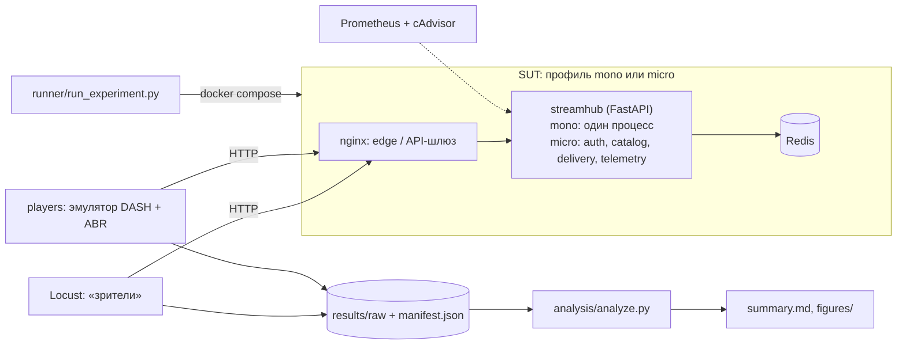

# Экспериментальный стенд «Платформа потокового видео MPEG-DASH»

Воспроизводимый стенд для двух выпускных квалификационных работ (задания 3 и 4 курса
«Проектирование и развёртывание веб-решений в экосистеме Python»).
Исполнители: Голиенко Роман, Митенева София.

| Работа | Тема | Вопрос, на который отвечает стенд |
|---|---|---|
| Голиенко Р. | Сравнительный анализ актуальных веб-архитектур для высоконагруженных систем | E1: как архитектура сервера (модульный монолит или микросервисы за API-шлюзом) при одинаковом бюджете CPU и памяти влияет на задержку и пропускную способность |
| Митенева С. | Анализ и сравнительная оценка алгоритмов адаптации битрейта в системах адаптивной потоковой передачи видео | E2: как алгоритм адаптации (по пропускной способности, BOLA, RobustMPC, FESTIVE) влияет на качество восприятия (QoE) в стабильной, 3G- и 4G-сети |
| Совместный | — | E3: ухудшает ли архитектура сервера под высокой нагрузкой QoE зрителей |

Отчёты: [docs/pr3-report.md](docs/pr3-report.md) (проект стенда, анализ статей) и
[docs/pr4-report.md](docs/pr4-report.md) (реализация, проверка стенда, результаты), а также их PDF-версии в `docs/`.

## Результаты (кратко)

Полный эксперимент выполнен дважды на машинах GitHub Actions (Intel Xeon Platinum 8573C, 4 vCPU, 16 ГБ) и в сокращённом виде на ПК с 1 CPU. Подробно — [docs/pr4-report.md](docs/pr4-report.md), таблицы — [results/processed/summary.md](results/processed/summary.md), графики — `results/figures/`.

| Эксперимент | Главный результат |
|---|---|
| Проверка стенда | A/A: p = 1,0, шум p95 11,5 %, MDE 16,7 %; калибровка без нагрузки: внесённые 20,5 мс видны как 20,3 мс [20,1; 20,4]; генератор ≤ 33 % лимита; тренда нет; выводы повторились во втором запуске |
| E1: монолит vs микросервисы | p95 сегмента: 57 против 187 мс при 300 зрителях (×3,3), 232 мс против 13,5 с при 900 (×58); δ Клиффа = +1, p (Холм) = 0,0004 |
| E2: алгоритмы ABR | RobustMPC — лучший QoE во всех сетях (+12…+32 % к rate) ценой остановок; BOLA-BASIC — без остановок, но частые переключения; FESTIVE — меньше переключений, ниже битрейт |
| E3: архитектура → QoE | при перегрузке микросервисов первый байт сегмента приходит через 3–5 с, QoE падает с ≈ 1 до −7…−18 |

## Архитектура

Диаграмма хранится как код: [docs/architecture.mmd](docs/architecture.mmd).



* **Объект исследования (SUT)** — сервис раздачи видео `sut/` (FastAPI). Один и тот же код
  собирается в один процесс (`ROLE=mono`) или в четыре сервиса (`auth`, `catalog`, `delivery`,
  `telemetry`), где выдача сегмента проверяет токен HTTP-вызовом сервиса `auth`. Суммарные лимиты
  одинаковы: приложение 1,75 CPU и 512 МБ, шлюз nginx 0,5 CPU (2 рабочих процесса).
* **Воздействие:** Locust (`load/locustfile.py`) — «зрители», которые раз в 4 с запрашивают сегмент
  и шлют телеметрию; эмулятор плееров (`players/`) — каждый плеер ограничивает полосу по сетевой
  трассе (как симулятор Pensieve, RTT 80 мс) и выбирает битрейт своим алгоритмом.
* **Данные** (`data/`): размеры 48 сегментов × 6 уровней (300–4300 кбит/с) из артефакта Pensieve;
  трассы `stable` (синтетика 3–6 Мбит/с), `hsdpa` (3G Norway HSDPA в нарезке Pensieve/Genet),
  `lte` (4G Belgium, масштаб 1:10). Контрольные суммы — `data/SHA256SUMS`, происхождение — в
  `tools/prepare_data.py`.
* **Измерения:** сырые задержки каждого запроса (`requests.csv.gz`), CSV Locust, журнал сегментов
  каждого плеера, `docker stats` раз в ~2 с, экспорт Prometheus; манифест прогона `manifest.json`
  (коммит, образы с digest, параметры, сиды, время, машина, лимиты).

## Требования

* Docker Engine 24+ с Compose v2.17+ (`docker compose up --wait`), Linux или Docker Desktop.
* [uv](https://docs.astral.sh/uv/) 0.5.11 (ставит Python 3.12 и зависимости по `uv.lock`).
* GNU make и bash (на Windows — Git Bash).
* Ресурсы по умолчанию рассчитаны на 4 vCPU / 16 ГБ (раннер GitHub Actions). На меньшей машине
  лимиты задаются переменными окружения, см. «Запуск на слабой машине».

## Сценарий проверки (что выполнит проверяющий)

```bash
git clone https://github.com/SolarVonBro/streaming-research-stand.git
cd streaming-research-stand
git checkout v1.0.0            # тег версии, по которой написан отчёт
make setup                     # окружение хоста по uv.lock
make test                      # данные по SHA-256, линтер, 18 модульных тестов -> "passed"
make smoke                     # оба варианта SUT -> строка "SMOKE: пройден"
make ci-experiment             # сокращённый эксперимент, ~10 мин
make analyze                   # results/processed/summary.md, results/figures/*.png
```

Что должно получиться:

1. `make test`: `data: OK` и все тесты пройдены. Калибровочный тест канала: сегмент 150 000 байт
   по каналу 2 Мбит/с с RTT 80 мс загружается за 0,68 с ± 5 %.
2. `make smoke`: все строки `[OK]`, в конце `SMOKE: пройден`.
3. Полный эксперимент (`make experiment`, ~6 ч на 4 vCPU) воспроизводит выводы отчёта ПР4:
   направление эффектов и их величина по δ Клиффа должны совпасть; медианы p95 могут отличаться
   на величину шума стенда из A/A-теста (CoV p95 приведён в `summary.md`), QoE — в пределах
   bootstrap-интервалов. На машине с другим числом ядер абсолютные задержки будут другими
   (см. отчёт ПР4, раздел об ограничениях), направление эффекта E1 — нет.
4. Тот же сценарий автоматически выполняется в GitHub Actions на каждый push (`.github/workflows/ci.yml`),
   полный эксперимент — вручную (`experiment.yml`, Actions → experiment → Run workflow).

## Сырые данные и пересчёт без повторения эксперимента

Сырые данные (`results/raw`, `results/repeat/raw`, `results/local/raw`, `results/history`) не хранятся в git, а опубликованы архивами с контрольными суммами в релизе [v1.0.0](https://github.com/SolarVonBro/streaming-research-stand/releases/tag/v1.0.0):

```bash
sha256sum -c SHA256SUMS                    # проверить скачанные архивы
tar -xzf raw-main.tar.gz -C results        # основной запуск -> results/raw
make analyze                               # results/processed и results/figures
tar -xzf raw-repeat.tar.gz -C results      # повторный запуск -> results/repeat/raw
uv run python analysis/analyze.py --raw results/repeat/raw --out results/repeat
uv run python analysis/compare_runs.py results/processed/summary.json     results/repeat/processed/summary.json --labels "запуск 1" "запуск 2" --out results/processed/repeatability.md
```

Эксперимент выполнен на коммите `435c07c` (калибровка — на `d8e5768`); тег `v1.0.0` отличается от него только анализом, отчётами и калибровкой. Коммит каждого прогона записан в его `manifest.json`.

## Команды

| Команда | Что делает |
|---|---|
| `make setup` | `uv sync --frozen` — окружение хоста строго по `uv.lock` |
| `make test` | проверка данных по `data/SHA256SUMS`, `ruff`, `pytest` |
| `make smoke` | поднимает `mono`, затем `micro`; проверяет контракт API, 401 без токена, детерминизм сегментов, метрики Prometheus и сбор cAdvisor |
| `make pilot` | пилот для выбора уровней нагрузки E1 (`configs/pilot-e1.yaml`) |
| `make experiment` | все эксперименты по порядку: A/A E1, калибровка, E1, A/A E2, E2, E3 |
| `make experiment CONFIG=configs/e2-abr.yaml` | один эксперимент |
| `make ci-experiment` | сокращённые E1 и E2 (`configs/ci/`) |
| `make analyze` | таблицы и графики из `results/raw` |
| `make up ARCH=micro` | поднять вариант SUT и мониторинг для ручного изучения (Prometheus — http://127.0.0.1:9090) |
| `make down` | остановить и удалить контейнеры стенда |

## Конфигурация эксперимента

Все параметры — в `configs/*.yaml`, в коде их нет:

```yaml
name: e1-architecture
kind: load                 # load | abr | joint
seed: 20261118             # порядок прогонов и выбор трасс
factors: {arch: [mono, micro], users: [300, 900]}   # полный факторный план
repetitions: 10
warmup_seconds: 20         # в анализ не идёт: статистика Locust сбрасывается
duration_seconds: 60
randomize_order: true
recreate_sut: true         # SUT и Redis пересоздаются перед каждым прогоном
```

Раннер печатает план без запуска: `uv run python runner/run_experiment.py configs/e2-abr.yaml --dry-run`.

## Запуск на слабой машине

Лимиты контейнеров задаются переменными окружения (значения по умолчанию — в `docker-compose.yml`).
Пример для Docker Desktop с 2 CPU, все лимиты уменьшены вдвое:

```bash
export EDGE_CPUS=0.25 APP_CPUS=0.875 AUTH_CPUS=0.25 CATALOG_CPUS=0.075 DELIVERY_CPUS=0.375 \
       TELEMETRY_CPUS=0.175 REDIS_CPUS=0.25 LOAD_CPUS=0.5 PLAYERS_CPUS=0.25
make experiment CONFIG=configs/ci/ci-e1.yaml
```

Лимиты, с которыми выполнен прогон, записываются в `manifest.json` (поле `resources`).

## Структура репозитория

```
├── README.md                 как воспроизвести
├── Makefile                  setup / test / smoke / experiment / analyze / down
├── docker-compose.yml        весь стенд; образы закреплены по тегу и digest
├── pyproject.toml, uv.lock   окружение хоста (раннер, анализ, тесты)
├── configs/                  эксперименты: факторы, уровни, повторения, сиды
│   └── ci/                   сокращённые конфигурации для CI
├── sut/                      объект исследования: Dockerfile, uv.lock, app/
├── gateway/                  конфигурации nginx: mono.conf, micro.conf
├── load/locustfile.py        «зрители» для E1 и фоновой нагрузки E3
├── players/                  эмулятор плееров: канал по трассе, алгоритмы ABR
├── monitoring/               prometheus.yml, источник данных Grafana
├── runner/                   run_experiment.py (оркестрация, манифесты), smoke.py
├── analysis/                 analyze.py, stats.py
├── data/                     размеры сегментов, трассы, SHA256SUMS (версионируются в git)
├── tools/prepare_data.py     как получены данные (скачивание, проверка SHA-256, конвертация)
├── tests/                    модульные тесты эмулятора и анализа
├── results/
│   ├── raw/                  сырые данные основного запуска (в .gitignore; архив — в Releases)
│   ├── processed/, figures/  таблицы, summary.md, repeatability.md, графики основного запуска
│   ├── repeat/               повторный запуск (processed/, figures/)
│   ├── local/                проверка на ПК с 1 CPU (processed/, figures/, журналы)
│   └── history/              ранние версии калибровки (в .gitignore; архив — в Releases)
└── docs/                     отчёты ПР3 и ПР4 (Markdown и PDF), architecture.mmd
```

## Происхождение данных и лицензии

* Размеры сегментов — артефакт Pensieve (MIT), коммит `1120bb1`, `video_server/video1..6`.
* Трассы `hsdpa` — тестовая выборка репозитория GenetProject/Genet (коммит `5d4303b`), исходно
  набор Riiser et al. (MMSys 2013). Соответствие файлов — `data/traces/hsdpa_sources.csv`.
* Трассы `lte` — набор van der Hooft et al. (IEEE Communications Letters, 2016), архив
  `logs_all.zip` (SHA-256 в `tools/prepare_data.py`); координаты GPS удалены.
* Трассы `stable` — синтетические, сид 20261118.

Код стенда распространяется по лицензии MIT (`LICENSE`).
