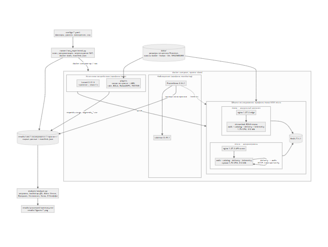

<div class="title-page" align="center">
<p class="tp-org">Министерство науки и высшего образования Российской Федерации<br>федеральное государственное автономное образовательное учреждение высшего образования<br><strong>«Национальный исследовательский университет ИТМО»</strong></p>
<div class="tp-center">
<h1>ОТЧЁТ</h1>
<p>о выполнении задания 3</p>
<p class="tp-topic">«Проектирование экспериментального стенда.<br>Требования к эксперименту из практики предметной области»</p>
<p class="tp-parts">Стенд «Платформа потокового видео MPEG-DASH»<br>для двух выпускных квалификационных работ</p>
</div>
<p class="tp-authors">Выполнили:<br>Голиенко Роман<br>Митенева София</p>
<p class="tp-city">Санкт-Петербург<br>2026</p>
</div>

<!-- web-only -->
> Версия для печати: [otchet-zadanie-3.pdf](otchet-zadanie-3.pdf) (все ссылки в файле кликабельны).
> Реализация стенда и результаты эксперимента — в отчёте по заданию 4: [pr4-report.md](pr4-report.md).
<!-- /web-only -->

## Введение

Экспериментальная часть выпускной работы убедительна, только если её результат можно получить снова и проверить. Для этого нужно заранее решить, что именно измерять, какие условия фиксировать, сколько раз повторять прогоны, какой статистикой обрабатывать результат и как передать всё это другому человеку. Ответы на эти вопросы не придумываются с нуля: они следуют из того, как работают исследователи в предметной области, и из ошибок, которые в этих работах встречаются.

**Цель работы** — вывести требования к собственному эксперименту из практики двух предметных областей и на их основе спроектировать один экспериментальный стенд для двух выпускных квалификационных работ (ВКР).

Задачи:

1. подобрать не менее шести статей по теме каждой ВКР с учётом требований к подборке;
2. разобрать методику каждой статьи по единой схеме из 12 полей и оценить воспроизводимость;
3. обобщить практику эксперимента в обеих областях и типичные ошибки;
4. сформулировать критерии научности применительно к нашим ВКР: исследовательские вопросы, гипотезы, переменные, критерии успеха;
5. описать, как другой разработчик проверит результаты, и составить сценарий проверки;
6. спроектировать стенд: архитектура, компоненты, окружение, план эксперимента, проверка самого стенда, угрозы валидности, структура репозитория.

Стенд реализован в публичном репозитории <https://github.com/SolarVonBro/streaming-research-stand>; реализация, проверка стенда и результаты описаны в отчёте по заданию 4.

## 1. Темы ВКР и постановка задачи

Работа выполнена двумя исполнителями с разными темами ВКР:

- **«Подготовка и проведение сравнительного анализа актуальных веб-архитектур для высоконагруженных систем»** (Голиенко Р.). В научно-исследовательской работе (НИР) построена система из десяти критериев сравнения монолитной и микросервисной архитектур с пятибалльной экспертной шкалой; производительность и масштабируемость оценены экспертно, а их проверка нагрузочными замерами прототипов названа следующим шагом [23].
- **«Анализ и сравнительная оценка алгоритмов адаптации битрейта в системах адаптивной потоковой передачи видеоконтента»** (Митенева С.). В НИР алгоритмы FESTIVE, BOLA, MPC и Pensieve сопоставлены качественно по результатам из статей, полученным в несопоставимых условиях; следующим шагом названо моделирование алгоритмов «в одинаковых экспериментальных условиях» [24].

Обе темы сходятся на одной системе — платформе потокового видео: в НИР по архитектурам потоковый сервис прямо назван примером высоконагруженной системы. Поэтому спроектирован **один общий стенд** «Платформа потокового видео MPEG-DASH». Сервер раздачи видео — объект исследования для первой темы: он собирается из одного кода либо как модульный монолит, либо как четыре микросервиса за API-шлюзом. Эмулированные плееры с разными алгоритмами адаптации битрейта (ABR, adaptive bitrate) — объект исследования для второй темы. Плееры же служат источником нагрузки, а совместный вопрос связывает темы: влияет ли архитектура сервера на качество восприятия видео (QoE, quality of experience) у зрителей.

## 2. Подборка статей

### 2.1. Как искали

Поиск вёлся в Google Scholar, Semantic Scholar, ACM Digital Library, IEEE Xplore, arXiv и КиберЛенинке по сочетаниям «monolith microservices performance evaluation / benchmark / empirical study» и «adaptive bitrate streaming evaluation / trace-driven / QoE». Отбирались работы с собственным экспериментом и открытым полным текстом. Для каждой статьи метаданные сверены по Crossref, DOI проверены через doi.org, наличие и содержимое артефактов — через GitHub API и Zenodo. Методика выписывалась из полного текста, а не из аннотации.

### 2.2. Соответствие требованиям

Требования выполнены отдельно для каждой темы (таблица 1).

*Таблица 1 — Соответствие подборок требованиям задания*

| Требование | Тема 1 (архитектуры), статьи [1]–[7] | Тема 2 (ABR), статьи [8]–[16] |
|---|---|---|
| не менее 6 статей | 7 | 9 |
| не менее 4 с экспериментом | 7 из 7 | 9 из 9 |
| не менее 3 за последние 5 лет (2022–2026) | 4: [1] 2022, [2] 2024, [3] 2024, [7] 2025 (+ [4] 2021) | 3: [13] 2022, [15] 2022, [16] 2024 (+ [14] 2021) |
| не менее 2 из рецензируемых изданий | 6: IEEE [1], [2]; Elsevier [3]; ACM [5], [6]; журнал из перечня ВАК [7] | 9: ACM [8], [10]–[13], [16]; IEEE [9], [14], [15] |
| желательно не менее 1 с артефактом | 7 (все) | 5: [10], [12], [13], [15], [16] |

Русскоязычная работа с экспериментом найдена только по первой теме [7]. По второй теме проверены статьи из КиберЛенинки и eLibrary (Рогов и др., Вестник ВГТУ, 2017; Елагин и др., T-Comm, 2019; Пастушок, Информационно-управляющие системы, 2017): это обзоры или алгоритмы без эксперимента, поэтому в анализ они не включены.

## 3. Анализ статей глазами экспериментатора

Каждая статья разобрана по 12 полям задания. Если в статье чего-то нет, это записано как «не указано». Воспроизводимость оценена по шкале задания: 0 — описания недостаточно даже для повторения идеи; 1 — методика описана, артефактов нет; 2 — есть код или данные, но окружение не зафиксировано; 3 — есть артефакт с зафиксированным окружением. В конце раздела приведена сводная таблица по ключевым полям.

### 3.1. Тема 1: монолит и микросервисы

**[1] Blinowski, Ojdowska, Przybyłek — IEEE Access, 2022**

| Поле | Содержание |
|---|---|
| Ссылка | Blinowski G., Ojdowska A., Przybyłek A. Monolithic vs. Microservice Architecture: A Performance and Scalability Evaluation // IEEE Access. 2022. Vol. 10. P. 20357–20374. DOI: 10.1109/ACCESS.2022.3152803 |
| Вопрос | Насколько различается производительность монолита и микросервисов; какой способ масштабирования выбирать; когда технология (Java или C#) даёт преимущество |
| Объект | Собственное приложение в четырёх функционально одинаковых версиях с двумя REST-методами: лёгкий City (один объект) и тяжёлый Route (эвристика задачи коммивояжёра на 10 000 точек) |
| Факторы | Локально — полный план 2 × 2 × 2: архитектура, метод, язык. В облаке Azure — дробный план по типу машины (от 1 до 4 CPU) и числу экземпляров (1–20) |
| Метрики | Пропускная способность, запросов/с (число запросов JMeter, делённое на время прогона); стоимость, долларов в сутки. Задержка и CPU не измерялись |
| Условия | Ноутбук Intel i7-9850H (6 ядер / 12 потоков), 32 ГБ, Windows 10; Java 8 + Spring Boot 2.3.0, C# 8 + ASP.NET Core 3.1; шлюз Netflix Zuul, Eureka. Версия JMeter и сеть до облака не указаны |
| Стенд | Apache JMeter; локально шлюз и сервисы на одной машине, в облаке — PaaS Azure без контейнеров; мониторинга ресурсов нет |
| Методика | Локально City — 1000 вызовов, Route — 100, 10 потоков, каждый прогон повторён 20 раз; в облаке серия из 5 повторов, «медиана медиан». Прогрев и порядок прогонов не указаны |
| Статистика | Медианы, диаграммы размаха в репозитории; доверительных интервалов и тестов значимости нет |
| Угрозы | Авторы: единственная метрика, неконтролируемое облако, двухсервисное приложение. Мы: облачные значения (3–12 запросов/с) упираются в клиент или сеть, а не в архитектуру; в данных есть вариант с gRPC, не описанный в тексте |
| Артефакты | Код: <https://github.com/annaojdowska/monolith-vs-microservices> ; сырые данные и скрипты R: <https://github.com/przybylek/Monolith-vs-Microservices> . Нет Dockerfile и планов JMeter |
| Воспроизводимость | **2** — код и данные есть, окружение и сценарии нагрузки не зафиксированы |

**[2] Berry, Castelltort, Lange и др. — IEEE ICWS, 2024**

| Поле | Содержание |
|---|---|
| Ссылка | Berry V., Castelltort A., Lange B. [et al.] Is it Worth Migrating a Monolith to Microservices? An Experience Report on Performance, Availability and Energy Usage // 2024 IEEE International Conference on Web Services (ICWS). Shenzhen: IEEE, 2024. P. 944–954. DOI: 10.1109/ICWS62655.2024.00112 |
| Вопрос | Улучшает ли вынос самой тяжёлой операции в отдельный сервис производительность и доступность по сравнению с монолитом и его репликами; как влияет число реплик; как меняются ресурсы и энергия |
| Объект | Учебное приложение ShellOnYou (Node.js, React, PostgreSQL): сценарий «вход — проверка — отправка решения на проверку — выход» |
| Факторы | Монолит без балансировщика и с 1–12 репликами за HAProxy; микросервисная версия с 1–12 репликами каждого сервиса и 1–2 шлюзами. Интенсивность фиксирована: до 200 виртуальных пользователей в секунду |
| Метрики | Доли успешных и неуспешных запросов; доли ответов быстрее 800 мс и медленнее 1200 мс, индекс Apdex; запросов/с; CPU, %; память; энергия по ваттметру. Перцентилей нет |
| Условия | Сервер Intel i9-10920X (12 ядер), 128 ГБ, Debian 12, Docker 20.10.24; клиент — такая же машина в той же проводной сети |
| Стенд | Docker Compose, Gatling, Telegraf + Grafana на отдельном сервере, физический ваттметр |
| Методика | По 10 прогонов на конфигурацию, пауза 30 с, очистка БД после прогона; разгон 60 с и 60 с полной нагрузки. Отдельного прогрева нет, порядок конфигураций не указан |
| Статистика | Только средние по 10 прогонам |
| Угрозы | Авторы: один сервер, общая БД, одно приложение. Мы: режим намеренно перегрузочный, времена считаются только по успешным ответам (смещение выживших); выигрыш во многом даёт буферизация шлюза, а не декомпозиция |
| Артефакты | <https://github.com/ShellOnYou/SOY_loadTests> (сценарии Gatling, скрипты, результаты), <https://github.com/ShellOnYou/SOY_Monolith> и <https://github.com/ShellOnYou/SOY_MS_HTTP> (Dockerfile, docker-compose, package-lock) |
| Воспроизводимость | **3** с оговорками — контейнеры, lock-файлы, скрипты и данные есть; нет тега версии «как в статье», энергия требует ваттметра |

**[3] Faustino, Gonçalves, Portela, Rito Silva — Performance Evaluation, 2024**

| Поле | Содержание |
|---|---|
| Ссылка | Faustino D., Gonçalves N., Portela M., Rito Silva A. Stepwise migration of a monolith to a microservice architecture: Performance and migration effort evaluation // Performance Evaluation. 2024. Vol. 164. Art. 102411. DOI: 10.1016/j.peva.2024.102411 |
| Вопрос | Каковы трудозатраты и потери производительности на шагах «монолит — модульный монолит — микросервисы» |
| Объект | Цифровой архив LdoD (Java, Spring Boot, ORM; 71 сущность): четыре функции, от списка источников до вычислительно тяжёлого упорядочивания |
| Факторы | Архитектура (3 уровня), функция (4), объём БД (100 и 720 фрагментов) |
| Метрики | Средняя задержка, мс; пропускная способность, запросов/с; доля изменённых сущностей; время сериализации |
| Условия | Docker на выделенной машине: Intel i7 (6 ядер), 16 ГБ, SSD. Версии ПО и размещение генератора нагрузки не указаны |
| Стенд | Apache JMeter, docker-compose |
| Методика | Один пользователь, 50 последовательных запросов после одного прогревочного; повторы серий и порядок не указаны |
| Статистика | Средние и относительные изменения в процентах |
| Угрозы | Авторы: один случай миграции, зависимость от технологии. Мы: нагрузка однопоточная (это задержка, а не масштабируемость); кэши добавлены только в микросервисную версию, версии не равноценны |
| Артефакты | <https://github.com/socialsoftware/edition> (ветки master, modular-monolith, microservices; Dockerfile, docker-compose, pom.xml, планы JMeter). Результатов нет |
| Воспроизводимость | **2** — код, контейнеры и сценарии есть, нет тега версии, скрипта прогона и данных |

**[4] Bjørndal, Pires de Araújo, Bucchiarone и др. — Journal of Object Technology, 2021**

| Поле | Содержание |
|---|---|
| Ссылка | Bjørndal N., Pires de Araújo L. J., Bucchiarone A. [et al.] Benchmarks and performance metrics for assessing the migration to microservice-based architectures // Journal of Object Technology. 2021. Vol. 20, No. 2. P. 2:1–17. DOI: 10.5381/jot.2021.20.2.a3 |
| Вопрос | Методика и набор метрик для оценки миграции; гипотеза — микросервисы масштабируются лучше |
| Объект | Библиотечный сервис на ASP.NET Core 3: монолит с одной БД и четыре микросервиса со своими БД и шиной сообщений |
| Факторы | Архитектура; простая или сложная нагрузка; интенсивность ступенями по 2 500 запросов/мин; 2 или 4 ядра; в облаке — конфигурации Azure |
| Метрики | Средняя задержка, мс; пропускная способность (успешные ответы не дольше 200 мс); масштабируемость; CPU, память, сеть |
| Условия | Сервер Intel i5-4590 (4 ядра), 8 ГБ — на нём и API, и БД; клиент по Wi-Fi 2,4 ГГц; монолит без контейнера, микросервисы в Kubernetes из Docker Desktop |
| Стенд | JMeter (таймер постоянной интенсивности), Windows Performance Monitor; Azure Load Testing |
| Методика | Ступени нагрузки до превышения средней задержки 200 мс; повторы и прогрев не указаны |
| Статистика | Средние; регрессия для интерполяции ёмкости |
| Угрозы | Авторы: Wi-Fi, фоновые процессы, подбор числа подов, холодный старт облачной БД. Мы: архитектура смешана с окружением (монолит без контейнеров, микросервисы в Kubernetes) |
| Артефакты | <https://github.com/NichlasBjorndal> (репозитории LibraryService-*: код, Dockerfile, манифесты Kubernetes, часть данных); планов JMeter нет |
| Воспроизводимость | **2** |

**[5] Eismann, Bezemer, Shang и др. — ACM/SPEC ICPE, 2020**

| Поле | Содержание |
|---|---|
| Ссылка | Eismann S., Bezemer C.-P., Shang W. [et al.] Microservices: A Performance Tester's Dream or Nightmare? // Proceedings of the ACM/SPEC International Conference on Performance Engineering (ICPE '20). New York: ACM, 2020. P. 138–149. DOI: 10.1145/3358960.3379124 |
| Вопрос | Стабильно ли окружение микросервисов между повторами; стабильны ли результаты нагрузочных тестов; насколько надёжно обнаруживается деградация производительности |
| Объект | Эталонное приложение TeaStore 1.3.0 (5 сервисов) в Google Kubernetes Engine, профиль «просмотр магазина» |
| Факторы | Шесть сценариев развёртывания (в том числе автомасштабирование и внесённая деградация на 10 % и 30 %), интенсивность 700, 800, 900 запросов/с |
| Метрики | Время отклика, с; суммарное время занятости CPU; число экземпляров; площадь под ROC-кривой при обнаружении деградации |
| Условия | GKE 1.11.6; 20 узлов по 1 vCPU или 5 узлов по 4 vCPU; по 8 экземпляров сервиса с лимитами 2 CPU / 3 ГБ |
| Стенд | Terraform, YAML-манифесты, генератор нагрузки с открытой моделью (по интенсивности поступления) |
| Методика | Прогон: 20 мин прогрева + 5 мин измерения; по 10 повторов, всего 180 прогонов. Порядок не указан, рандомизацию авторы предлагают на будущее |
| Статистика | Тест Манна–Уитни (p < 0,05) и δ Клиффа; Уилкоксон, Колмогоров–Смирнов, ROC |
| Угрозы | Авторы: одна система и одно облако, облачная изменчивость. Мы: нет монолитного контроля; единица анализа — среднее по прогону, N = 10 |
| Артефакты | Zenodo, DOI 10.5281/zenodo.3582707 (скрипты, данные, анализ) |
| Воспроизводимость | **3** — пакет прошёл рецензирование артефактов; но те версии GKE уже недоступны |

**[6] Gan, Zhang, Cheng и др. — DeathStarBench, ACM ASPLOS, 2019**

| Поле | Содержание |
|---|---|
| Ссылка | Gan Y., Zhang Y., Cheng D. [et al.] An Open-Source Benchmark Suite for Microservices and Their Hardware-Software Implications for Cloud & Edge Systems // Proceedings of ASPLOS '19. New York: ACM, 2019. P. 3–18. DOI: 10.1145/3297858.3304013 |
| Вопрос | Какие последствия микросервисы имеют для аппаратуры, ОС, сети и управления кластером в сравнении с монолитами |
| Объект | Пять сквозных приложений (социальная сеть, медиасервис, магазин, банк, IoT) и монолитная версия социальной сети |
| Факторы | Приложение, архитектура, интенсивность; частота CPU; RPC или REST; размер кластера 40–200 узлов; доля медленных серверов |
| Метрики | Хвостовая задержка; максимальная интенсивность при соблюдении целевой задержки; доля времени на сетевую обработку; IPC |
| Условия | 20 двухсокетных 40-ядерных Xeon, 10GbE, Ubuntu 16.04, турбо-режим и энергосбережение отключены; Docker |
| Стенд | Генератор с открытой моделью (wrk2), собственная распределённая трассировка, Intel VTune |
| Методика | Число повторов и длительность прогонов не указаны |
| Статистика | Точечные значения, диаграммы размаха на части графиков; тестов нет |
| Угрозы | Раздела нет. Мы: «сравнение с монолитом» местами сделано с одноуровневыми сервисами, монолитные версии не опубликованы |
| Артефакты | <https://github.com/delimitrou/DeathStarBench> (docker-compose, Helm, wrk2) |
| Воспроизводимость | **2** — сам бенчмарк контейнеризован, но эксперименты статьи повторить нельзя |

**[7] Чикалева Ю. С. — Программные системы и вычислительные методы, 2025**

| Поле | Содержание |
|---|---|
| Ссылка | Чикалева Ю. С. Анализ гранулярности микросервисов: эффективность архитектурных подходов // Программные системы и вычислительные методы. 2025. № 2. С. 79–93. DOI: 10.7256/2454-0714.2025.2.74386 |
| Вопрос | Как способ выделения сервисов (монолит, DDD, по данным, вынос одного сервиса) влияет на производительность, доступность, масштабируемость и согласованность |
| Объект | Менеджер задач на Spring Boot + MySQL в четырёх конфигурациях |
| Факторы | Конфигурация архитектуры (4 уровня); нагрузка фиксирована |
| Метрики | Время отклика, с; запросов/с; загрузка CPU; доступность; время запуска экземпляра, с |
| Условия | AMD Ryzen 3 5300U (4 ядра), 8 ГБ, Windows 11, Docker |
| Стенд | Apache JMeter 5.6.3, Prometheus (интервал 1 с); всё на одном компьютере |
| Методика | 1000 потоков, разгон 10 с, по 10 итераций; повторы, прогрев и порядок не указаны |
| Статистика | В аннотации заявлены средние и СКО, в таблице только средние; тестов нет |
| Угрозы | Автор: один хост с 8 ГБ. Мы: генератор и объект на одной машине без ограничений ресурсов; окно усреднения пропускной способности (5 мин) длиннее теста (~35 с); разрыв в 10 раз подозрительно велик |
| Артефакты | <https://github.com/Yuliya3003/Microservices_research> (Dockerfile, docker-compose, pom.xml); сценария нагрузки и данных нет |
| Воспроизводимость | **2** |

### 3.2. Тема 2: алгоритмы адаптации битрейта

**[8] Yin, Jindal, Sekar, Sinopoli — MPC, ACM SIGCOMM, 2015**

| Поле | Содержание |
|---|---|
| Ссылка | Yin X., Jindal A., Sekar V., Sinopoli B. A Control-Theoretic Approach for Dynamic Adaptive Video Streaming over HTTP // Proceedings of SIGCOMM '15. New York: ACM, 2015. P. 325–338. DOI: 10.1145/2785956.2787486 |
| Вопрос | Превосходит ли управление с прогнозом (MPC), объединяющее прогноз пропускной способности и буфер, алгоритмы по пропускной способности и по буферу, и как это зависит от сети |
| Объект | QoE сессий эталонного плеера dash.js на записанных трассах пропускной способности |
| Факторы | Алгоритм (RB, BB, FastMPC, RobustMPC, dash.js, FESTIVE); набор трасс (FCC, HSDPA, синтетика); в анализе чувствительности — ошибка прогноза, веса QoE, размер буфера, число уровней |
| Метрики | QoE = Σq(R) − λΣ\|Δq\| − μ·ребуферизация − μs·задержка старта (q в кбит/с, λ = 1, μ = μs = 3000); QoE, нормированный на офлайн-оптимум; средний битрейт; время ребуферизации |
| Условия | Видео 260 с (65 сегментов по 4 с), 5 уровней 350–3000 кбит/с; буфер 30 с; по 1000 трасс в наборе |
| Стенд | Два компьютера Ubuntu 12.04, Chrome 39, node.js 0.10.32, ограничение канала Linux tc; анализ чувствительности — в симуляторе |
| Методика | Сравнение распределений по трассам; сколько трасс прогнано в эмуляции, повторы и порядок не указаны |
| Статистика | Функции распределения, медианы; интервалов и тестов нет |
| Угрозы | Авторы: нет точного предсказателя полосы, один плеер без конкурирующего трафика. Мы: нормированный QoE несопоставим с абсолютным; FESTIVE реализован упрощённо |
| Артефакты | Не опубликованы |
| Воспроизводимость | **1** — методика и параметры описаны подробно, артефактов нет |

**[9] Spiteri, Urgaonkar, Sitaraman — BOLA, IEEE/ACM ToN, 2020**

| Поле | Содержание |
|---|---|
| Ссылка | Spiteri K., Urgaonkar R., Sitaraman R. K. BOLA: Near-Optimal Bitrate Adaptation for Online Videos // IEEE/ACM Transactions on Networking. 2020. Vol. 28, No. 4. P. 1698–1711. DOI: 10.1109/TNET.2020.2996964 (первая версия — IEEE INFOCOM 2016) |
| Вопрос | Можно ли выбирать битрейт только по буферу, без прогноза полосы, с доказуемой близостью к оптимуму |
| Объект | Средняя полезность воспроизведения, битрейт, доля ребуферизации, колебания битрейта |
| Факторы | Варианты BOLA и параметр V; размер буфера; длина видео; 12 сетевых профилей и 85 трасс 3G; базовые алгоритмы ELASTIC, PANDA, RobustMPC, Pensieve |
| Метрики | Полезность ln(S_m/S_1); средний битрейт, Мбит/с; отношение ребуферизации к воспроизведению, %; среднее изменение битрейта |
| Условия | Видео 10 мин, 10 уровней 0,23–6 Мбит/с, сегменты 3 с; задержка 50 мс в одну сторону; γp = 5 с; при сравнении буфер 25 с у всех |
| Стенд | Симуляция (позже опубликована как Sabre [12]) |
| Методика | Каждая трасса — один прогон (симуляция детерминирована); верхняя граница — офлайн-оптимум |
| Статистика | Средние по профилям; дисперсии и тестов нет |
| Угрозы | Авторы: реализация BOLA в dash.js 2.0–2.5 содержала ошибки, сравнения с ней некорректны. Мы: нет модели TCP; используется полезность, а не линейный QoE |
| Артефакты | Кода к статье нет; BOLA доступна в dash.js и Sabre; трассы 3G публичны |
| Воспроизводимость | **2** |

**[10] Mao, Netravali, Alizadeh — Pensieve, ACM SIGCOMM, 2017**

| Поле | Содержание |
|---|---|
| Ссылка | Mao H., Netravali R., Alizadeh M. Neural Adaptive Video Streaming with Pensieve // Proceedings of SIGCOMM '17. New York: ACM, 2017. P. 197–210. DOI: 10.1145/3098822.3098843 |
| Вопрос | Превосходит ли политика, обученная с подкреплением, эвристики BB, RB, BOLA и MPC в разных сетях и при разных целевых QoE |
| Объект | Средний QoE на сегмент и его составляющие в dash.js под эмуляцией сети Mahimahi и в реальных сетях |
| Факторы | Алгоритм; набор трасс (FCC, Norway HSDPA, синтетика); вариант QoE (линейный, логарифмический, HD) |
| Метрики | QoE_lin = Σ R [Мбит/с] − 4,3·ребуферизация [с] − Σ\|ΔR\|, нормированный на число сегментов |
| Условия | dash.js 2.4, буфер 60 с; видео EnvivioDash3: 48 сегментов по 4 с, 6 уровней 300–4300 кбит/с; Chrome 53; RTT 80 мс; трассы по 320 с, средняя полоса от 0,2 до 6 Мбит/с |
| Стенд | Модифицированный dash.js, сервер алгоритмов на Python, Mahimahi; обучение в собственном симуляторе |
| Методика | Тест на 20 % трасс (более 30 ч); в реальных сетях по 10 загрузок каждой схемой в случайном порядке |
| Статистика | Среднее ± стандартное отклонение, функции распределения; тестов нет |
| Угрозы | Авторы: неточность симулятора, одно видео. Мы: BOLA взята из версии dash.js, которую авторы BOLA считают ошибочной; фильтр трасс смещает выборку |
| Артефакты | <https://github.com/hongzimao/pensieve> (MIT): симулятор, эталонные реализации MPC и BB, сегменты видео; трассы — по ссылке Dropbox |
| Воспроизводимость | **2** — зависимости не закреплены, код на Python 2 |

**[11] Jiang, Sekar, Zhang — FESTIVE, ACM CoNEXT, 2012**

| Поле | Содержание |
|---|---|
| Ссылка | Jiang J., Sekar V., Zhang H. Improving Fairness, Efficiency, and Stability in HTTP-based Adaptive Video Streaming with FESTIVE // Proceedings of CoNEXT '12. New York: ACM, 2012. P. 97–108. DOI: 10.1145/2413176.2413189 |
| Вопрос | Почему плееры на общем узком месте ведут себя несправедливо, неэффективно и нестабильно, и можно ли это исправить на стороне клиента |
| Объект | Группа плееров на общем канале |
| Факторы | Плеер (FESTIVE и эмуляции коммерческих плееров), компоненты FESTIVE, α от 5 до 30, число плееров 2–30, изменчивость канала |
| Метрики | Неэффективность, несправедливость (через индекс Джайна), нестабильность (взвешенные изменения битрейта за 20 с) — безразмерные |
| Условия | Видео 10 мин, 8 уровней 350–2750 кбит/с, сегменты 2 с; Dummynet, 10 плееров на 10 Мбит/с |
| Стенд | Собственные клиент и сервер на Java; прототип в OSMF |
| Методика | 15 прогонов на конфигурацию со случайным временем прихода плееров |
| Статистика | Медиана по 15 прогонам и разброс (тип не указан) |
| Угрозы | Авторы: эмуляции коммерческих плееров приближённые. Мы: нет реальных трасс, метрики про справедливость, а не QoE |
| Артефакты | Нет (сторонняя реализация — в dash.js из [10]) |
| Воспроизводимость | **1** |

**[12] Spiteri, Sitaraman, Sparacio — Sabre, ACM TOMM, 2019**

| Поле | Содержание |
|---|---|
| Ссылка | Spiteri K., Sitaraman R., Sparacio D. From Theory to Practice: Improving Bitrate Adaptation in the DASH Reference Player // ACM Transactions on Multimedia Computing, Communications, and Applications. 2019. Vol. 15, No. 2s. Art. 67. DOI: 10.1145/3336497 |
| Вопрос | Как довести BOLA до эталонного плеера dash.js и даёт ли гибрид DYNAMIC (по полосе при малом буфере, BOLA при большом) лучшее из обоих классов |
| Объект | Сессии в симуляторе Sabre: доля ребуферизации, средний битрейт, колебания, время реакции |
| Факторы | Алгоритм (BOLA, BOLA-E, THROUGHPUT, DYNAMIC); буфер 25 или 10 с; видео SD и HD; трассы 3G, 4G, FCC |
| Метрики | Доля ребуферизации = ребуферизация / (ребуферизация + воспроизведение); битрейт, кбит/с; среднее \|Δ битрейта\|, кбит/с |
| Условия | 86 трасс 3G Norway и 40 трасс 4G Belgium с шагом 1 с; видео 10 мин, 10 уровней 0,23–6 Мбит/с, сегменты 3 с; THROUGHPUT выбирает уровень ниже 90 % оценки |
| Стенд | Sabre (Python); проверка соответствия на 20 сессиях в dash.js |
| Методика | Одна сессия на трассу и алгоритм (детерминированно) |
| Статистика | Функции распределения, медианы, 90-й перцентиль; для проверки симулятора — средняя ошибка и СКО |
| Угрозы | Авторы: Sabre не моделирует TCP и аудио. Мы: проверка всего на 20 сессиях; MPC в Sabre нет |
| Артефакты | <https://github.com/UMass-LIDS/sabre> (BSD-2): код, трассы 3G и 4G, скрипты построения графиков |
| Воспроизводимость | **2** (почти 3: нужна только стандартная библиотека Python, но версия не закреплена) |

**[13] Xia, Zhou, Yan, Jiang — Genet, ACM SIGCOMM, 2022**

| Поле | Содержание |
|---|---|
| Ссылка | Xia Z., Zhou Y., Yan F. Y., Jiang J. Genet: Automatic Curriculum Generation for Learning Adaptation in Networking // Proceedings of the ACM SIGCOMM 2022 Conference. New York: ACM, 2022. P. 397–413. DOI: 10.1145/3544216.3544243 |
| Вопрос | Улучшает ли обучение по учебному плану (сначала среды, где обучаемая политика сильнее всего проигрывает правиловому алгоритму) политики ABR и их перенос на реальные трассы |
| Объект | Суммарная награда политик ABR на синтетике, трассах FCC и Norway, в эмуляции и на реальных путях |
| Факторы | Метод обучения; правиловый эталон (MPC или BBA); доля реальных трасс; параметры среды (буфер 2–100 с, сегмент 1–10 с, RTT 20–1000 мс) |
| Метрики | Награда на сегмент = битрейт [Мбит/с] − 10·ребуферизация [с] − \|Δ битрейта\|; её составляющие |
| Условия | FCC: 85 трасс для обучения и 290 для теста; Norway: 115 и 310; эмуляция — стенд Pensieve (dash.js 2.4, Mahimahi, RTT 80 мс) |
| Стенд | Python, симулятор Pensieve, единый интерфейс обучения и тестирования |
| Методика | 200 новых синтетических сред; тестовые наборы трасс; на реальных путях каждый алгоритм не менее 5 раз подряд |
| Статистика | Средние, 90-й перцентиль; интервалов и тестов нет |
| Угрозы | Авторы: нужен разумный правиловый эталон; реальные пути не доказывают обобщения. Мы: вес ребуферизации 10, абсолютные значения несопоставимы с [10] |
| Артефакты | <https://github.com/GenetProject/Genet> : трассы, симулятор, эталонные MPC и BBA, скрипт установки с закреплёнными версиями, run.sh для каждого рисунка |
| Воспроизводимость | **3** с оговорками — версии закреплены, но контейнера нет, модели во внешнем хранилище |

**[14] Taraghi, Nguyen, Amirpour, Timmerer — INTENSE, IEEE Access, 2021**

| Поле | Содержание |
|---|---|
| Ссылка | Taraghi B., Nguyen M., Amirpour H., Timmerer C. INTENSE: In-Depth Studies on Stall Events and Quality Switches and Their Impact on the Quality of Experience in HTTP Adaptive Streaming // IEEE Access. 2021. Vol. 9. P. 118087–118098. DOI: 10.1109/ACCESS.2021.3107619 |
| Вопрос | Какую минимальную остановку замечает зритель; что хуже — остановка или переключение качества; несколько коротких остановок или одна длинная; насколько объективные модели QoE согласуются с оценками людей |
| Объект | Субъективные оценки (MOS, шкала 1–5) участников краудсорсинга и предсказания моделей ITU-T P.1203 и др. |
| Факторы | Длительность остановки (1 мс – 1 с), шаблоны остановок, уровень качества, видеоролик |
| Метрики | MOS; доля незамеченных остановок; корреляции Пирсона и Спирмена, RMSE моделей |
| Условия | 4 ролика, сегменты 2 с, 5 уровней 235–7000 кбит/с; методика ITU-T P.910 |
| Стенд | Веб-портал на AWS Lambda с собственным плеером, участники Amazon MTurk; CAdViSE, реализация P.1203 |
| Методика | 713 участников (452 прошли проверки надёжности); пробная последовательность, контрольные вопросы, рандомизированная выдача роликов |
| Статистика | Однофакторный дисперсионный анализ, апостериорные тесты Геймса–Хауэлла, α = 0,05 |
| Угрозы | Авторы: расхождение с частью работ. Мы: условия просмотра не контролируются; остановки вставлены искусственно, алгоритмы ABR не сравниваются |
| Артефакты | Данные не опубликованы; инструменты открыты: <https://github.com/cd-athena/CAdViSE> , <https://github.com/itu-p1203/itu-p1203> |
| Воспроизводимость | **1** |

**[15] Bentaleb, Akcay, Lim и др. — LoL+, IEEE Transactions on Multimedia, 2022**

| Поле | Содержание |
|---|---|
| Ссылка | Bentaleb A., Akcay M. N., Lim M. [et al.] Catching the Moment With LoL+ in Twitch-Like Low-Latency Live Streaming Platforms // IEEE Transactions on Multimedia. 2022. Vol. 24. P. 2300–2314. DOI: 10.1109/TMM.2021.3079288 |
| Вопрос | Удерживает ли LoL+ низкую задержку прямого эфира при высоком QoE лучше алгоритмов LoL, L2A, STALLION и Dynamic |
| Объект | Сессии прямого эфира с пакетной передачей CMAF |
| Факторы | Алгоритм (5); 11 сетевых профилей, в том числе трассы Belgium LTE; целевая задержка 1,5/2/3 с; варианты весов и управления скоростью |
| Метрики | QoE с весами битрейта, ребуферизации, задержки и скорости воспроизведения; задержка, с; переключения; ошибка оценки полосы |
| Условия | Видео 3 уровня 200–1000 кбит/с, сегмент 500 мс; dash.js 3.0.1; Chrome 86; ограничение канала через инструменты разработчика Chrome |
| Стенд | Ноутбук с двумя виртуальными машинами: плеер в Chrome и источник (FFmpeg + сервер на Python) |
| Методика | 5 прогонов на профиль, среднее |
| Статистика | Только средние и нормированные оценки |
| Угрозы | Авторы: чувствительность к выбору функции QoE. Мы: ограничение канала на уровне приложения, 3 уровня, 5 прогонов |
| Артефакты | <https://github.com/NUStreaming/LoL-plus> (Apache-2.0): dash.js, сервер, скрипт запуска, package-lock.json |
| Воспроизводимость | **2** — lock-файл есть, браузер, ОС и FFmpeg не закреплены |

**[16] Wu, Wang, Qiao и др. — NetLLM, ACM SIGCOMM, 2024**

| Поле | Содержание |
|---|---|
| Ссылка | Wu D., Wang X., Qiao Y. [et al.] NetLLM: Adapting Large Language Models for Networking // Proceedings of the ACM SIGCOMM 2024 Conference. New York: ACM, 2024. P. 661–678. DOI: 10.1145/3651890.3672268 |
| Вопрос | Может ли большая языковая модель (Llama2-7B), адаптированная методом NetLLM, выбирать битрейт лучше BBA, MPC и Genet — на распределении обучения, на новых видео и трассах и в эмуляции реальной сети (разобрана только часть про ABR) |
| Объект | Клиентская политика выбора битрейта для каждого сегмента: языковая модель с энкодером признаков, дообученная офлайн на траекториях Genet |
| Факторы | Алгоритм (NetLLM, BBA, RobustMPC, Genet); условия: обучающее и три «невиданных» сочетания видео и трасс (FCC, синтетика); тип и размер языковой модели; абляция компонентов |
| Метрики | QoE = Σ(битрейт [Мбит/с] − 4,3·ребуферизация [с] − \|Δ битрейта\|) / C — та же QoE_lin, что в [10]; время обучения, ч; память GPU, ГБ; время решения, с |
| Условия | Сервер 8 × Xeon Gold 5318Y, 2 × A100 40 ГБ; видео Envivio из [10] (по коду: 6 уровней 300–4300 кбит/с, 48 сегментов по 4 с); 100 тестовых трасс FCC; в реальном тесте по 100 трасс FCC и 3G Norway |
| Стенд | Трассовый симулятор Genet/Pensieve (RTT 80 мс, буфер 60 с); эмуляция — стенд Genet: dash.js 2.4, Chrome 87, Mahimahi |
| Методика | Одна сессия на трассу, 100 трасс на условие; число сидов, повторы, прогрев и порядок не указаны |
| Статистика | Средние с «усами» неуказанного смысла, функции распределения, диаграммы размаха; тестов и интервалов нет |
| Угрозы | Авторы: вычислительная цена, гиперпараметры не подбирались, данные для обучения собраны одним алгоритмом. Мы: постановка ABR вынесена в приложение, которое не рецензировалось; Genet взят готовым, а не переобучен под условия; у пользователей повторное обучение дало худший QoE (обсуждение в репозитории) |
| Артефакты | <https://github.com/duowuyms/NetLLM> (MIT): код, трассы FCC, размеры сегментов, контрольные точки; версии только перечислены в README, lock-файлов и Dockerfile нет |
| Воспроизводимость | **2** — код и данные открыты, окружение закреплено лишь частично, данных для «невиданных» условий нет |


### 3.3. Сводная таблица

*Таблица 2 — Сводная таблица анализа методики (ключевые поля)*

| № | Факторы | Главная метрика | Повторения, прогрев | Статистика | Артефакт | Балл |
|---|---|---|---|---|---|---|
| [1] | архитектура × метод × язык | запросов/с | 20 прогонов; прогрева нет | медианы | код, данные | 2 |
| [2] | архитектура × реплики | доля успешных, Apdex | 10 прогонов; прогрева нет | средние | контейнеры, скрипты, данные | 3 |
| [3] | шаг миграции × функция × объём БД | средняя задержка | 1 запрос прогрева, 50 запросов | средние | код, контейнеры | 2 |
| [4] | архитектура × нагрузка × ядра | ёмкость при 200 мс | не указано | средние, регрессия | код, часть данных | 2 |
| [5] | сценарий × интенсивность | время отклика | 10 прогонов, прогрев 20 мин | Манн–Уитни, δ Клиффа | скрипты, данные (Zenodo) | 3 |
| [6] | приложение × архитектура × нагрузка | хвостовая задержка | не указано | точечные значения | бенчмарк | 2 |
| [7] | способ декомпозиции | время отклика | не указано | средние | код, контейнеры | 2 |
| [8] | алгоритм × трассы | нормированный QoE | 1000 трасс | распределения, медианы | нет | 1 |
| [9] | алгоритм × профиль × буфер | полезность, ребуферизация | 1 прогон на трассу | средние | косвенно (dash.js, Sabre) | 2 |
| [10] | алгоритм × трассы × вид QoE | QoE_lin на сегмент | тест 20 % трасс; 10 загрузок в поле | среднее ± СКО | код, видео | 2 |
| [11] | плеер × α × число плееров | нестабильность, справедливость | 15 прогонов | медианы | нет | 1 |
| [12] | алгоритм × буфер × трассы | ребуферизация, битрейт | 1 прогон на трассу | распределения, p90 | код, трассы | 2 |
| [13] | метод обучения × среда | награда на сегмент | ≥ 5 прогонов на реальных путях | средние | код, трассы, закреплённые версии | 3 |
| [14] | остановка × качество | MOS | 452 участника | ANOVA, Геймс–Хауэлл | инструменты | 1 |
| [15] | алгоритм × профиль × задержка | QoE, задержка | 5 прогонов | средние | код, lock-файл | 2 |
| [16] | алгоритм × условия × модель | QoE_lin на сегмент | 100 трасс на условие | средние, «усы» без пояснения | код, трассы, модели | 2 |

## 4. Синтез: практика экспериментов в предметных областях

### 4.1. Что и как измеряют

**Архитектуры веб-систем.** Почти все работы сравнивают архитектуры по пропускной способности (запросов в секунду) и задержке под нагрузкой от генератора — JMeter [1], [3], [4], [7], Gatling [2] или собственного генератора с открытой моделью нагрузки [5], [6]. Задержку обычно приводят как среднее [3], [4], [7] или долю ответов быстрее порога [2]; перцентили, на которые ориентируются в эксплуатации (p95, p99), есть только в работах [5] и [6]. Ресурсы (CPU, память) измеряют реже и разными средствами: Telegraf [2], Prometheus [7], Windows Performance Monitor [4]. Направление результата на одной машине у всех одно: монолит быстрее на лёгких запросах — в 1,4–1,9 раза по пропускной способности [1], в 2,3–4,6 раза по ёмкости при задержке 200 мс [4], вплоть до десятков раз по задержке при «болтливых» межсервисных вызовах [3]. Разница исчезает на вычислительно тяжёлых запросах (не более 5 % [1]). Преимущества микросервисов проявляются при горизонтальном масштабировании отдельных сервисов и в доступности при перегрузке [2].

**Алгоритмы адаптации битрейта.** Стандартом стал трассовый эксперимент: записанные трассы пропускной способности (FCC, Norway HSDPA, Belgium LTE) проигрываются через эмулятор канала (tc [8], Mahimahi [10], [13]) или симулятор [9], [12], а алгоритмы работают в настоящем или упрощённом плеере. Метрики — средний битрейт, время или доля ребуферизации, колебания битрейта, задержка старта и их линейная свёртка QoE_lin [8], [10]; веса свёртки различаются (μ = 3000 при кбит/с [8], 4,3 [10] и 10 [13] при Мбит/с), поэтому абсолютные значения QoE из разных статей сравнивать нельзя. Видео и лестница битрейтов кочуют из работы в работу: видео Envivio из [10] использовано в [9], [13]. Субъективная сторона QoE изучается отдельно [14]: остановки короче 4 мс не замечает никто, одна длинная остановка воспринимается лучше нескольких коротких той же длительности.

### 4.2. Типичные ошибки

1. **Нет статистики.** В 11 из 16 работ приводятся только средние или медианы без интервалов и тестов значимости. Тесты значимости есть лишь в двух: [5] (тест Манна–Уитни и δ Клиффа) и [14] (дисперсионный анализ); разброс приводят ещё [10] (стандартное отклонение), [12] (для проверки симулятора) и [16] («усы» без указания, что они означают).
2. **Повторения не описаны или их мало.** Число повторов не указано в [4], [6], [7], [8]; в [3] — 50 последовательных запросов без повторов серий; в [15] — 5 прогонов. Только [5] обосновывает число повторов (10 прогонов нужно для надёжного обнаружения деградации в 10 %).
3. **Прогрев и порядок прогонов не описаны** нигде, кроме [5] (20 мин прогрева); рандомизацию порядка не применяет ни одна работа, [5] лишь предлагает её.
4. **Архитектура смешана с окружением.** Монолит запускается без контейнера, а микросервисы — в Kubernetes [4]; генератор нагрузки и объект на одной машине без ограничений ресурсов [7]; клиент по Wi-Fi [4]; кэши добавлены только в один вариант [3]. Эффект архитектуры нельзя отделить от эффекта окружения.
5. **Метрика не соответствует вопросу.** Однопоточная нагрузка измеряет задержку, а не масштабируемость [3]; времена считаются только по успешным ответам в перегрузке [2]; окно усреднения длиннее самого теста [7].
6. **Несопоставимые условия при сравнении алгоритмов.** Базовые алгоритмы берутся из ошибочной версии плеера [10] (по свидетельству [9]), упрощаются [8], а веса QoE выбираются по-разному [8], [10], [13]. Именно эту проблему отмечает НИР по второй теме [24].
7. **Артефакты без окружения.** Код есть у большинства работ, но зафиксированное окружение (контейнеры, lock-файлы, скрипт запуска) — только у [2], [5], [13].

### 4.3. У кого методика лучше и почему

Лучшая методика в первой области — у [5]: открытая модель нагрузки, прогрев, 10 повторов с обоснованием, единица анализа «прогон», непараметрические тесты с размером эффекта, опубликованный пакет артефактов. Работа [2] сильна инженерно (Docker Compose, сценарии Gatling, 10 прогонов, очистка состояния), но ограничивается средними. Во второй области лучше всего воспроизводимы [13] (закреплённые версии и скрипт на каждый рисунок) и [12] (симулятор и трассы в одном репозитории); по строгости обработки выделяется [14]. Из этих работ стенд берёт: единицу анализа и статистику — из [5]; трассы и видео, совместимые с [10], [13], и линейный QoE с весом 4,3 — из [10]; модель канала без TCP с проверкой на известном результате — из [12]; контейнеры и сценарий запуска — из [2].

## 5. Критерии научности, вопросы, гипотезы и переменные

### 5.1. Исследовательские вопросы и гипотезы

**E1 (тема 1).** *Как архитектура серверной части платформы (модульный монолит или микросервисы за API-шлюзом) при одинаковом суммарном бюджете CPU и памяти влияет на задержку выдачи сегментов и пропускную способность при умеренной и высокой нагрузке?*

- H1₀: при каждом уровне нагрузки распределения p95 задержки сегмента (по прогонам) у двух архитектур совпадают.
- H1₁ (направленная): у микросервисного варианта p95 выше, и разница растёт с нагрузкой. Обоснование: на каждый сегмент микросервисный вариант делает дополнительный внутренний HTTP-вызов к сервису авторизации, а бюджет CPU разделён между пятью процессами; работы [1], [3], [4], [7] получили то же направление эффекта на одной машине.

**E2 (тема 2).** *Как алгоритм адаптации битрейта влияет на QoE и его составляющие в стабильной сети, в 3G-сети и в 4G-сети при одинаковых условиях?*

- H2₀: распределения QoE четырёх алгоритмов на одних и тех же трассах совпадают (для каждого профиля сети).
- H2₁ — частные направленные гипотезы, взятые из НИР [24] и статей:
  - (а) в 3G-сети RobustMPC даёт QoE выше, чем алгоритм по пропускной способности (rate): +10 % медианного QoE на HSDPA в [8];
  - (б) в нестабильных сетях (3G, 4G) BOLA даёт меньшую долю ребуферизации, чем rate, так как не зависит от прогноза полосы [9], [24];
  - (в) FESTIVE переключается реже, чем rate, так как его цель — стабильность [11];
  - (г) в стабильной сети различие QoE между алгоритмами меньше практически значимого порога: все алгоритмы получают высокий битрейт без остановок [24].

**E3 (совместный вопрос).** *Ухудшает ли выбор архитектуры сервера под высокой нагрузкой QoE зрителей, и одинаково ли для разных алгоритмов?*

- H3₀: при фоновой нагрузке 900 зрителей QoE плееров (rate и BOLA) на одних и тех же трассах одинаков для монолита и микросервисов.
- H3₁ (направленная): при микросервисном варианте QoE ниже, потому что большая задержка сервера уменьшает измеренную плеером пропускную способность.

### 5.2. Переменные

*Таблица 3 — Переменные экспериментов*

| Эксп. | Независимые (уровни) | Зависимые (единицы, как измеряются) | Контролируемые |
|---|---|---|---|
| E1 | архитектура: mono, micro; нагрузка: 300 и 900 зрителей (≈ 1/3 и ≈ 9/10 ёмкости монолита по пилоту) | p95 задержки запроса сегмента, мс — по сырому журналу запросов Locust за 60-секундное окно; p50, p99, мс; пропускная способность, запросов/с; доля ошибок, %; CPU объекта, ядер — по `docker stats` | лимиты CPU и памяти (приложение 1,75 CPU и 512 МБ, шлюз 0,25 CPU); один код и одни образы по digest; одинаковые настройки nginx и Redis; уровень сегмента 750 кбит/с; темп зрителя 4 с; прогрев 20 с; пересоздание контейнеров перед каждым прогоном; тип машины |
| E2 | алгоритм: rate, BOLA, RobustMPC, FESTIVE (внутри прогона); сеть: stable, hsdpa, lte; трасса — блок (10 на профиль) | QoE_lin на сегмент = (Σ R [Мбит/с] − 4,3·T_ребуф [с] − Σ\|ΔR\|) / N; средний битрейт, кбит/с; доля ребуферизации, % от длительности видео; число переключений; задержка старта, с — из журнала сегментов каждого плеера | видео (48 × 4 с, 6 уровней 300–4300 кбит/с из [10]); буфер 30 с; RTT 80 мс; трасса проигрывается с начала; архитектура mono без фоновой нагрузки; версия кода плеера |
| E3 | архитектура: mono, micro; алгоритм: rate, BOLA (внутри прогона) | QoE_lin на сегмент; медианное время до первого байта сегмента у плеера, мс; p95 фоновой нагрузки, мс | фон 900 зрителей; трассы hsdpa; остальное как в E2 |

### 5.3. Критерий успеха (практическая значимость)

- **E1:** различие практически значимо, если разность медиан p95 не меньше 10 % и δ Клиффа по модулю не меньше 0,474 («большой» эффект по порогам Романо [20]). Порог 10 % — тот, на котором надёжное обнаружение деградации требует 10 прогонов [5]; эффекты в статьях много больше (от 37 % до нескольких раз [1], [4]), поэтому 10 % — консервативная нижняя граница.
- **E2:** различие QoE практически значимо при разнице медиан не меньше 10 % от медианы rate (выигрыш RobustMPC в [8] — 10–15 %, Pensieve в [10] — 12–25 %); различие доли ребуферизации — при разнице не меньше 1 процентного пункта (≈ 2 с остановки на 192-секундном видео, что заметно зрителю [14]); различие числа переключений — не меньше 20 %.
- **E3:** QoE считается ухудшенным при парной разнице медиан не меньше 5 % и δ Клиффа по модулю не меньше 0,33.

Эффект, который меньше шума стенда, обнаружить нельзя. Поэтому до основного эксперимента A/A-тест определяет минимальный обнаружимый эффект (MDE); если он окажется больше порога практической значимости, план придётся усиливать.

### 5.4. Критерии научности применительно к стенду

*Таблица 4 — Критерии и способы их выполнения*

| Критерий | Как выполняется в работе |
|---|---|
| Объективность и измеримость | Каждая метрика определена операционально: что считается, по какому файлу и в каких единицах (таблица 3). Задержка берётся из сырого журнала каждого запроса, а не из округлённых перцентилей Locust; QoE вычисляется скриптом из журнала сегментов. Ручной обработки нет |
| Контроль переменных | Фиксируются: образы по digest, зависимости по lock-файлам, лимиты контейнеров, данные по SHA-256, параметры в YAML. Варьируются только факторы плана. Исказить результат могут: соседи на общей машине раннера, генератор нагрузки на той же машине, распределение CPU между микросервисами — для каждого есть мера (раздел 7.6) |
| Повторяемость | 10 повторений каждой конфигурации на одном стенде; A/A-тест показывает шум; повторный запуск `make experiment` с нуля должен дать те же выводы |
| Воспроизводимость | Другой человек на нашем артефакте: `git checkout v1.0.0`, `make setup`, `make experiment`, `make analyze`; манифест каждого прогона позволяет убедиться, что окружение то же (коммит, digest образов, лимиты, машина) |
| Реплицируемость | Описание (лестница, трассы, правила алгоритмов, модель буфера, план) достаточно для собственной реализации: например, на dash.js в браузере вместо эмулятора или на Go вместо Python. Ожидается согласие по направлению эффектов и порядку величин, а не по абсолютным числам |
| Внутренняя валидность | Один код в обоих вариантах архитектуры, одинаковый суммарный бюджет, пересоздание контейнеров, рандомизированный порядок, все алгоритмы проигрывают одну трассу в одном прогоне |
| Внешняя валидность | Реальные трассы 3G и 4G, лестница и размеры сегментов реального видео, типовой стек (nginx, FastAPI, Redis). Ограничения: одна машина, одно видео, синтетическое содержимое сегментов |
| Конструктная валидность | p95 задержки сегмента отражает то, что видит клиент (а не время обработки в приложении); QoE_lin — общепринятая свёртка [8], [10], её составляющие приводятся отдельно, так как перцептивное качество нелинейно [14] |
| Статистическая валидность | Единица анализа — прогон (E1) или сессия на трассе (E2, E3); непараметрические тесты (Манн–Уитни, Фридман, Уилкоксон), bootstrap-интервалы медиан, δ Клиффа, поправка Холма на множественные сравнения |
| Фальсифицируемость | H1₁ опровергается, если на обоих уровнях нагрузки p95 микросервисов не выше монолита или разница меньше 10 % и её интервал включает ноль. H2₁(а) опровергается, если медиана парной разницы QoE RobustMPC − rate на hsdpa меньше 10 % или отрицательна; H2₁(б) — если доля ребуферизации BOLA не ниже rate; H3₁ — если интервал парной разницы QoE включает ноль и эффект пренебрежимый |

Термины «повторяемость», «воспроизводимость» и «реплицируемость» понимаются по политике ACM Artifact Review and Badging [17]. Для нашего стенда разница такая: **воспроизводимость** — проверяющий запускает наш репозиторий и получает согласующиеся числа; **реплицируемость** — он пишет свой плеер или свой сервер по описанию и получает то же направление эффекта.

## 6. Как результаты проверят другие разработчики

### 6.1. Что фиксируется

*Таблица 5 — Уровни фиксации и инструменты*

| Что зафиксировать | Как | Инструменты в стенде |
|---|---|---|
| Код | версия и тег релиза | Git, тег `v1.0.0`, GitHub Releases; коммит и признак незакоммиченных изменений пишутся в каждый манифест |
| Зависимости | точные версии | `uv.lock` для хоста, объекта и плееров; сборка `uv sync --frozen` падает при рассинхронизации |
| Окружение | образы с тегом и digest | `docker-compose.yml` и Dockerfile: все базовые образы (python, uv, nginx, redis, locust, prometheus, cadvisor, grafana) закреплены `тег@sha256`; лимиты CPU и памяти — переменные окружения с записью в манифест |
| Данные | версии и контрольные суммы | `data/` в git, `data/SHA256SUMS`, `make data-verify`; источник каждого файла (коммит репозитория-источника, SHA-256 архива) — в `tools/prepare_data.py` |
| Конфигурация эксперимента | параметры вне кода | `configs/*.yaml`: факторы, уровни, повторения, прогрев, длительность, ресурсы |
| Случайность | сиды | сид эксперимента задаёт порядок прогонов и выбор трасс, сид прогона — точки старта зрителей и FESTIVE; содержимое сегментов — фиксированный сид; bootstrap — `random_state` |
| Запуск | одна команда | `make experiment`, `make analyze` |
| Метаданные прогона | что, где и когда | `manifest.json` в каждом прогоне: коммит, digest образов, параметры, сиды, лимиты, ОС, CPU, Docker, время начала и конца, статус |
| Независимая проверка | автоматический прогон | GitHub Actions: на каждый push — тесты, smoke-тест и сокращённый эксперимент; полный эксперимент — вручную |

### 6.2. Сценарий проверки

```bash
git clone https://github.com/SolarVonBro/streaming-research-stand.git && cd streaming-research-stand
git checkout v1.0.0
make setup            # окружение по uv.lock
make test             # data: OK; все модульные тесты пройдены
make smoke            # все проверки [OK], строка «SMOKE: пройден»
make experiment       # полный план, ~6 ч на 4 vCPU
make analyze          # results/processed/summary.md и results/figures/
```

Ожидаемый результат и допустимое расхождение:

1. `make test` — все тесты пройдены, включая калибровочный: сегмент 150 000 байт по каналу 2 Мбит/с с RTT 80 мс грузится за 0,68 с ± 5 %.
2. `make smoke` — оба варианта архитектуры отвечают по контракту, сегменты побайтно детерминированы, метрики собираются.
3. `make experiment` + `make analyze` — направление эффектов и их величина по δ Клиффа совпадают с отчётом по заданию 4. Медианы p95 могут отличаться в пределах шума стенда (коэффициент вариации из A/A-теста), QoE — в пределах bootstrap-интервалов. Абсолютные задержки на машине с другим процессором будут другими; выводы о направлении эффекта — нет.
4. Тот же сценарий в сокращённом виде выполняется в GitHub Actions; результат каждого запуска доступен во вкладке Actions репозитория.

## 7. Проект экспериментального стенда

### 7.1. Архитектура

Компонентная диаграмма хранится в репозитории как код в нотации Mermaid: [docs/architecture.mmd](architecture.mmd) (рисунок 1).



*Рисунок 1 — Компонентная диаграмма стенда*

Стенд состоит из пяти элементов:

- **объект исследования** — сервис раздачи видео streamhub: управление сессиями, каталог и манифест MPD, выдача сегментов с проверкой токена, приём телеметрии плеера; хранилище сессий и событий — Redis;
- **источники воздействия** — Locust с моделью «зрителя» (E1, фон в E3) и эмулятор DASH-плееров с ограничением канала по трассе и четырьмя алгоритмами ABR (E2, E3);
- **сбор измерений** — сырой журнал запросов Locust, журналы сегментов плееров, `docker stats`, Prometheus с cAdvisor и метриками приложения;
- **хранилище результатов** — каталог прогона `results/raw/<эксперимент>/<прогон>/` с сырыми файлами и `manifest.json`;
- **анализ** — `analysis/analyze.py`: таблицы, тесты и графики.

### 7.2. Спецификация компонентов

*Таблица 6 — Компоненты стенда*

| Компонент | Роль | Технология и версия | Образ | Обоснование |
|---|---|---|---|---|
| streamhub | объект E1: один код, роли mono / auth / catalog / delivery / telemetry | Python 3.12.8, FastAPI, uvicorn (uvloop, httptools), redis-py, httpx — версии по `uv.lock` | `python:3.12.8-slim-bookworm@sha256:2199a628…`, uv 0.5.11 | Один код в обоих вариантах — в отличие от [3], где кэши были только в одной версии, и от [4], где окружения различались; так эффект относится к архитектуре, а не к реализации |
| edge / API-шлюз | вход: в mono — обратный прокси, в micro — маршрутизация по сервисам | nginx 1.27.3 | `nginx:1.27.3-alpine@sha256:814a8e88…` | Шлюз есть в обоих вариантах, поэтому сравнивается декомпозиция, а не наличие шлюза: [2] показал, что сама буферизация шлюза меняет результат |
| Redis | сессии и поток событий | Redis 7.4.1 без сохранения на диск | `redis:7.4.1-alpine@sha256:c1e88455…` | Общее хранилище, как в [2] и [7]; без записи на диск, чтобы ввод-вывод не добавлял шума |
| Locust | нагрузка E1, фон E3 | Locust 2.31.5, FastHttpUser, constant_pacing 4 с | `locustio/locust:2.31.5@sha256:d9f2fe88…` | В отличие от закрытой модели JMeter в [1], [7], темп зрителя задан периодом сегмента, поэтому интенсивность не падает вместе с задержкой, как в открытой модели [5], [6]; сырые задержки пишутся в файл для перцентилей и ECDF |
| players | воздействие E2, измеритель E3 | Python 3.12, httpx, numpy; алгоритмы rate, BOLA-BASIC, RobustMPC, FESTIVE | собирается из `players/Dockerfile` (та же база) | Как в симуляторе [10], [12]: канал по трассе, RTT 80 мс, но поверх настоящего HTTP-сервера; реализации следуют [8], [9], [11] и эталонному коду [10], [12] |
| Prometheus | сбор метрик приложения и контейнеров | 2.54.1 | `prom/prometheus:v2.54.1@sha256:f6639335…` | Как в [7], но с интервалом 5 с и экспортом окна прогона, а не усреднением дольше теста |
| cAdvisor | метрики CPU и памяти контейнеров | 0.49.1 | `gcr.io/cadvisor/cadvisor:v0.49.1@sha256:3cde6faf…` | Независимая от генератора проверка его загрузки |
| Grafana | наблюдение вручную (необязательный профиль) | 11.2.0 | `grafana/grafana:11.2.0@sha256:408afb97…` | Для демонстрации; в анализ не входит |
| runner | план, запуск, манифесты | Python 3.12, PyYAML | хост, `uv.lock` | Одна команда на эксперимент; манифест прогона — то, чего не хватает [1], [4], [7] |
| analysis | статистика и графики | pandas, SciPy, matplotlib | хост, `uv.lock` | Методика [5]: прогон как единица, Манн–Уитни и δ Клиффа; плюс bootstrap-интервалы и поправка Холма |

### 7.3. Спецификация окружения

**Машины.** Основной эксперимент выполняется на раннере GitHub Actions `ubuntu-24.04` (4 vCPU, 16 ГБ, Docker Engine с Compose v2): это одинаковая для любого проверяющего, бесплатная для публичного репозитория и документированная среда. Модель процессора, ядро ОС и версия Docker каждого прогона пишутся в манифест. Проверка на другой машине — рабочий компьютер исполнителя (AMD Ryzen 5 5500U, 6 ядер / 12 потоков, 15 ГБ ОЗУ, Windows 10, Docker Desktop с WSL 2, которому выделены 1 CPU и 2 ГБ). Полный эксперимент на нём не запускается: свободного резерва памяти около 4 ГБ, и запуск рискует остановить рабочие программы.

*Таблица 7 — Ограничения ресурсов контейнеров (значения по умолчанию)*

| Контейнер | CPU | Память |
|---|---|---|
| edge / API-шлюз (оба варианта) | 0,25 | 64 МБ |
| mono: приложение (2 процесса uvicorn) | 1,75 | 512 МБ |
| micro: auth / catalog / delivery / telemetry | 0,5 / 0,15 / 0,75 / 0,35 (сумма 1,75) | по 128 МБ (сумма 512 МБ) |
| Redis | 0,5 | 256 МБ |
| Locust | 1,0 | 512 МБ |
| players | 0,5 | 256 МБ |
| Prometheus / cAdvisor | 0,25 / 0,25 | 256 / 192 МБ |

Бюджет между микросервисами распределён пропорционально ожидаемой доле работы: на каждый сегмент приходятся выдача (delivery), проверка токена (auth) и событие телеметрии (telemetry), а каталог вызывается один раз за сессию.

**Сеть.** Все контейнеры — в одной мостовой сети Docker на одной машине. Сетевые условия плееров задаются не сетью Docker, а эмуляцией канала по трассе в самом плеере (раздел 7.2), поэтому от машины они не зависят.

### 7.4. План эксперимента

*Таблица 8 — План экспериментов*

| Эксп. | План | Конфигураций | Повторений | Прогонов | Прогрев / измерение | Единица анализа |
|---|---|---|---|---|---|---|
| A/A E1 | одна конфигурация (mono, 900) | 1 | 10 | 10 | 20 с / 60 с | p95 за прогон |
| Калибровка E1 | внесённая задержка 0 / 20 мс (mono, 300) | 2 | 5 | 10 | 15 с / 40 с | p50 за прогон |
| E1 | полный 2 × 2 (архитектура × нагрузка) | 4 | 10 | 40 | 20 с / 60 с | p95 за прогон |
| A/A E2 | BOLA × 2 на одной трассе | 1 | 10 | 10 | — / всё видео (192 с) | QoE сессии |
| E2 | 4 алгоритма внутри прогона × 3 профиля сети | 12 | 10 трасс | 30 | — / всё видео | QoE сессии, парно по трассе |
| E3 | 2 архитектуры × 2 алгоритма внутри прогона | 4 | 10 трасс | 20 | 20 с фона / всё видео | QoE сессии, парно по трассе |

**Число повторений.** 10 на конфигурацию: столько же использовали [2] и [5], причём [5] показал, что меньшее число повторов не обнаруживает деградацию в 10 % надёжно. В E2 и E3 повторение — это новая трасса из профиля: статьи используют сотни трасс в симуляции [8], [10], но в реальном времени одна сессия длится около 3,5 мин, поэтому выбран парный план (все алгоритмы на одной трассе), который даёт мощность за счёт исключения различий между трассами. Достаточность проверяется MDE по A/A-тесту.

**Прогрев и длительность.** В E1 прогрев 20 с: за 4 с порождаются все зрители, ещё несколько периодов уходят на установление соединений и пулов; затем статистика Locust сбрасывается. Окно измерения 60 с даёт при 900 зрителях около 13 500 запросов сегментов, чего достаточно для устойчивого p95 одного прогона. В отличие от [5] (прогрев 20 мин) здесь нет автомасштабирования и JIT-компиляции, которым нужен долгий прогрев. В E2 прогрева нет: старт сессии с пустым буфером — часть измеряемого поведения алгоритма.

**Порядок прогонов** перемешивается генератором с сидом эксперимента; перед каждым прогоном объект и Redis пересоздаются, чтобы кэши, сессии и возможные утечки памяти не переносились между прогонами.

**Методы анализа.** Описательные: медиана, межквартильный размах, коэффициент вариации, 95 % bootstrap-интервал медианы. E1: тест Манна–Уитни (двусторонний) для каждого уровня нагрузки, разность медиан с bootstrap-интервалом, δ Клиффа, поправка Холма на два уровня; отношение медиан micro/mono для проверки роста эффекта с нагрузкой. E2: тест Фридмана по четырём алгоритмам (блоки — трассы), попарный тест Уилкоксона для связанных выборок с поправкой Холма на 6 пар, медиана парной разности с bootstrap-интервалом, δ Клиффа. E3: тест Уилкоксона mono против micro для каждого алгоритма с поправкой Холма. Графики: диаграммы размаха с точками прогонов, ECDF задержки, метрика по порядковому номеру прогона.

### 7.5. Проверка самого стенда

1. **Smoke-тест** (`make smoke`): оба варианта поднимаются, отвечают по контракту API, отказывают без токена, отдают побайтно одинаковые сегменты, отдают метрики Prometheus; cAdvisor собирается.
2. **A/A-тесты:** для E1 — 10 прогонов одной конфигурации, случайно разделённые на две группы по 5 (плюс доля значимых среди всех 126 разбиений, ожидается около 5 %); для E2 — два одинаковых плеера BOLA в каждом прогоне. Разброс между прогонами — шум стенда, из него симуляцией оценивается MDE.
3. **Генератор не узкое место:** загрузка CPU Locust и эмулятора плееров по `docker stats` в каждом прогоне ниже 80 % их лимита; эмулятор плееров дополнительно сам измеряет свою долю ядра.
4. **Калибровка на известном результате:** (а) модульный тест канала — известное время загрузки на постоянной трассе; (б) эксперимент «калибровка E1» — в выдачу сегмента вносится задержка 20 мс, стенд должен показать прирост медианы p50 на 20 мс (интервал должен содержать 20).
5. **Стабильность во времени:** нормированная метрика (значение / медиана своей конфигурации) по порядку прогонов, коэффициент корреляции Спирмена; систематического тренда быть не должно.

### 7.6. Угрозы валидности и меры против них

*Таблица 9 — Угрозы и меры*

| Угроза | Вид | Мера |
|---|---|---|
| Шум общей машины раннера в облаке («шумные соседи») | внутренняя, статистическая | A/A-тест и MDE в том же задании CI, рандомизация порядка, все сравнения блока на одной машине [18], [19] |
| Генератор нагрузки на той же машине конкурирует с объектом | внутренняя | лимиты cgroup на все контейнеры, контроль CPU генератора < 80 % лимита; в отличие от [7] |
| Распределение CPU между микросервисами предопределяет результат | конструктная | одинаковая сумма бюджета; распределение по доле работы описано явно; ограничение указывается при выводах |
| Закрытая модель нагрузки занижает задержку при перегрузке | конструктная | темп зрителя 4 с (интенсивность задана), учёт пропускной способности и доли ошибок |
| Холодный старт, кэши, утечки между прогонами | внутренняя | прогрев 20 с вне окна измерения, пересоздание контейнеров и Redis перед каждым прогоном |
| Эмуляция канала без динамики TCP | конструктная, внешняя | одинакова для всех алгоритмов; калибровочный тест; аналогичный подход в [12] даёт ошибку 2,3 % относительно dash.js |
| Содержимое сегментов синтетическое, качество = битрейт | конструктная | алгоритмам важен только размер; размеры взяты из реального видео [10]; QoE_lin как в [8], [10], составляющие приводятся отдельно [14] |
| Трассы 4G масштабированы 1:10 | внешняя | дополнительно реальные немасштабированные трассы 3G HSDPA, как в [8], [10], [13] |
| Выбор трасс | внутренняя | случайная выборка с сидом, одни трассы для всех алгоритмов |
| Отклонения реализаций алгоритмов от авторских | конструктная | модульные тесты поведения, сверка с [9], [11] и эталонным кодом [10], [12]; отклонения описаны в коде и отчёте |
| Множественные сравнения | статистическая | поправка Холма |
| Ненормальные распределения задержек и QoE | статистическая | непараметрические тесты, bootstrap-интервалы, δ Клиффа |
| Запросы внутри прогона зависимы | статистическая | единица анализа — прогон или сессия, а не запрос |
| Одна машина, одно видео | внешняя | ограничение указывается; проверка на второй машине (рабочий компьютер, 1 CPU) |

### 7.7. Структура репозитория

```
streaming-research-stand/
├── README.md, LICENSE        как воспроизвести; лицензия MIT
├── Makefile                  setup / test / smoke / experiment / analyze / down
├── docker-compose.yml        весь стенд; профили mono, micro, monitoring, dashboards, tools
├── pyproject.toml, uv.lock   окружение хоста: раннер, анализ, тесты
├── configs/                  эксперименты (YAML); ci/ — сокращённые конфигурации
├── sut/                      объект исследования: Dockerfile, pyproject.toml, uv.lock, app/
├── gateway/                  nginx: mono.conf, micro.conf
├── load/locustfile.py        модель «зрителя»
├── players/                  эмулятор плееров: канал по трассе, алгоритмы ABR
├── monitoring/               prometheus.yml, источник данных Grafana
├── runner/                   run_experiment.py (план, манифесты), smoke.py
├── analysis/                 analyze.py, stats.py
├── data/                     размеры сегментов, трассы, SHA256SUMS
├── tools/prepare_data.py     происхождение и подготовка данных
├── tests/                    модульные тесты эмулятора и анализа
├── results/                  raw/ (в .gitignore, архив — в Releases), processed/, figures/
├── docs/                     отчёты ПР3, ПР4 (Markdown, PDF), architecture.mmd
└── .github/workflows/        ci.yml (каждый push), experiment.yml (полный эксперимент)
```

## 8. Применение искусственного интеллекта при выполнении работы

Работа выполнена с помощью ассистента Claude Code (модель Claude Opus 5.5). Ассистент искал статьи и сверял их метаданные по Crossref, читал полные тексты и заполнял поля анализа, предлагал архитектуру стенда и писал код. Решения о составе стенда, о темах и об объёме принимали исполнители. Все фактические утверждения о статьях проверены по первоисточникам: при сверке найдены и исправлены расхождения (например, DOI работы [4] в Crossref зарегистрирован под другим заголовком, поэтому ссылка дана по странице журнала; размер видео в репозитории [10] — 49 сегментов, а в статье — 48). Ассистент не используется как источник фактов: каждое число в разделах 3 и 4 взято из текста статьи или из её артефакта.

## Заключение

Подобраны и разобраны 16 статей: 7 по архитектурам веб-систем и 9 по алгоритмам адаптации битрейта; требования к подборке выполнены для каждой темы отдельно. Анализ показал, что обе области измеряют результат в основном без статистики: тесты значимости есть только в 2 работах из 16, разброс — ещё в трёх, порядок прогонов не рандомизирует ни одна, а при сравнении архитектур эффект архитектуры часто смешан с различием окружений. Лучшие практики (прогон как единица анализа, 10 повторов, непараметрические тесты с размером эффекта [5]; общие трассы, видео и линейный QoE [10], [13]; контейнеры и сценарии запуска [2]) перенесены в проект стенда.

Сформулированы три исследовательских вопроса с гипотезами H₀/H₁, операциональные определения переменных и пороги практической значимости, опирающиеся на величины эффектов из статей. Спроектирован один стенд для двух ВКР: сервис раздачи видео в двух архитектурах с одинаковым бюджетом ресурсов и эмулированные плееры с четырьмя алгоритмами на реальных трассах 3G и 4G. Для каждого уровня проверяемости выбран инструмент, сценарий проверки исполняется одной командой, а сам стенд проверяется smoke-тестом, A/A-тестами, контролем генератора, калибровкой на известном результате и анализом тренда. Реализация и результаты описаны в отчёте по заданию 4.

## Список использованных источников

1. Blinowski G., Ojdowska A., Przybyłek A. Monolithic vs. Microservice Architecture: A Performance and Scalability Evaluation // IEEE Access. 2022. Vol. 10. P. 20357–20374. DOI: 10.1109/ACCESS.2022.3152803.
2. Berry V., Castelltort A., Lange B. [et al.] Is it Worth Migrating a Monolith to Microservices? An Experience Report on Performance, Availability and Energy Usage // 2024 IEEE International Conference on Web Services (ICWS). Shenzhen: IEEE, 2024. P. 944–954. DOI: 10.1109/ICWS62655.2024.00112.
3. Faustino D., Gonçalves N., Portela M., Rito Silva A. Stepwise migration of a monolith to a microservice architecture: Performance and migration effort evaluation // Performance Evaluation. 2024. Vol. 164. Art. 102411. DOI: 10.1016/j.peva.2024.102411.
4. Bjørndal N., Pires de Araújo L. J., Bucchiarone A. [et al.] Benchmarks and performance metrics for assessing the migration to microservice-based architectures // Journal of Object Technology. 2021. Vol. 20, No. 2. P. 2:1–17. DOI: 10.5381/jot.2021.20.2.a3.
5. Eismann S., Bezemer C.-P., Shang W. [et al.] Microservices: A Performance Tester's Dream or Nightmare? // Proceedings of the ACM/SPEC International Conference on Performance Engineering (ICPE '20). New York: ACM, 2020. P. 138–149. DOI: 10.1145/3358960.3379124.
6. Gan Y., Zhang Y., Cheng D. [et al.] An Open-Source Benchmark Suite for Microservices and Their Hardware-Software Implications for Cloud & Edge Systems // Proceedings of the 24th International Conference on Architectural Support for Programming Languages and Operating Systems (ASPLOS '19). New York: ACM, 2019. P. 3–18. DOI: 10.1145/3297858.3304013.
7. Чикалева Ю. С. Анализ гранулярности микросервисов: эффективность архитектурных подходов // Программные системы и вычислительные методы. 2025. № 2. С. 79–93. DOI: 10.7256/2454-0714.2025.2.74386.
8. Yin X., Jindal A., Sekar V., Sinopoli B. A Control-Theoretic Approach for Dynamic Adaptive Video Streaming over HTTP // Proceedings of the 2015 ACM Conference on Special Interest Group on Data Communication (SIGCOMM '15). New York: ACM, 2015. P. 325–338. DOI: 10.1145/2785956.2787486.
9. Spiteri K., Urgaonkar R., Sitaraman R. K. BOLA: Near-Optimal Bitrate Adaptation for Online Videos // IEEE/ACM Transactions on Networking. 2020. Vol. 28, No. 4. P. 1698–1711. DOI: 10.1109/TNET.2020.2996964.
10. Mao H., Netravali R., Alizadeh M. Neural Adaptive Video Streaming with Pensieve // Proceedings of the Conference of the ACM Special Interest Group on Data Communication (SIGCOMM '17). New York: ACM, 2017. P. 197–210. DOI: 10.1145/3098822.3098843.
11. Jiang J., Sekar V., Zhang H. Improving Fairness, Efficiency, and Stability in HTTP-based Adaptive Video Streaming with FESTIVE // Proceedings of the 8th International Conference on Emerging Networking Experiments and Technologies (CoNEXT '12). New York: ACM, 2012. P. 97–108. DOI: 10.1145/2413176.2413189.
12. Spiteri K., Sitaraman R., Sparacio D. From Theory to Practice: Improving Bitrate Adaptation in the DASH Reference Player // ACM Transactions on Multimedia Computing, Communications, and Applications. 2019. Vol. 15, No. 2s. Art. 67. DOI: 10.1145/3336497.
13. Xia Z., Zhou Y., Yan F. Y., Jiang J. Genet: Automatic Curriculum Generation for Learning Adaptation in Networking // Proceedings of the ACM SIGCOMM 2022 Conference. New York: ACM, 2022. P. 397–413. DOI: 10.1145/3544216.3544243.
14. Taraghi B., Nguyen M., Amirpour H., Timmerer C. INTENSE: In-Depth Studies on Stall Events and Quality Switches and Their Impact on the Quality of Experience in HTTP Adaptive Streaming // IEEE Access. 2021. Vol. 9. P. 118087–118098. DOI: 10.1109/ACCESS.2021.3107619.
15. Bentaleb A., Akcay M. N., Lim M. [et al.] Catching the Moment With LoL+ in Twitch-Like Low-Latency Live Streaming Platforms // IEEE Transactions on Multimedia. 2022. Vol. 24. P. 2300–2314. DOI: 10.1109/TMM.2021.3079288.
16. Wu D., Wang X., Qiao Y. [et al.] NetLLM: Adapting Large Language Models for Networking // Proceedings of the ACM SIGCOMM 2024 Conference (SIGCOMM '24). New York: ACM, 2024. P. 661–678. DOI: 10.1145/3651890.3672268.
17. Artifact Review and Badging — Current. Version 1.1 // Association for Computing Machinery : [сайт]. URL: <https://www.acm.org/publications/policies/artifact-review-and-badging-current> (дата обращения: 18.11.2026).
18. Papadopoulos A. V., Versluis L., Bauer A. [et al.] Methodological Principles for Reproducible Performance Evaluation in Cloud Computing // IEEE Transactions on Software Engineering. 2021. Vol. 47, No. 8. P. 1528–1543. DOI: 10.1109/TSE.2019.2927908.
19. Laaber C., Scheuner J., Leitner P. Software microbenchmarking in the cloud. How bad is it really? // Empirical Software Engineering. 2019. Vol. 24, No. 4. P. 2469–2508. DOI: 10.1007/s10664-019-09681-1.
20. Romano J., Kromrey J. D., Coraggio J., Skowronek J. Appropriate statistics for ordinal level data: Should we really be using t-test and Cohen's d for evaluating group differences on the NSSE and other surveys? // Annual Meeting of the Florida Association of Institutional Research. Cocoa Beach, 2006.
21. Riiser H., Vigmostad P., Griwodz C., Halvorsen P. Commute path bandwidth traces from 3G networks: analysis and applications // Proceedings of the 4th ACM Multimedia Systems Conference (MMSys '13). New York: ACM, 2013. P. 114–118. DOI: 10.1145/2483977.2483991.
22. van der Hooft J., Petrangeli S., Wauters T. [et al.] HTTP/2-Based Adaptive Streaming of HEVC Video Over 4G/LTE Networks // IEEE Communications Letters. 2016. Vol. 20, No. 11. P. 2177–2180. DOI: 10.1109/LCOMM.2016.2601087.
23. Голиенко Р. В. Подготовка и проведение сравнительного анализа актуальных веб-архитектур для высоконагруженных систем : отчёт о научно-исследовательской работе. Санкт-Петербург : Университет ИТМО, 2026. 55 с.
24. Митенева С. Е. Анализ и сравнительная оценка алгоритмов адаптации битрейта в системах адаптивной потоковой передачи видеоконтента : отчёт о научно-исследовательской работе. Санкт-Петербург : Университет ИТМО, 2026.
