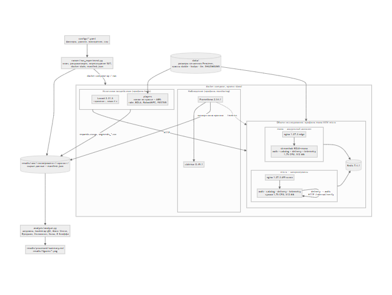
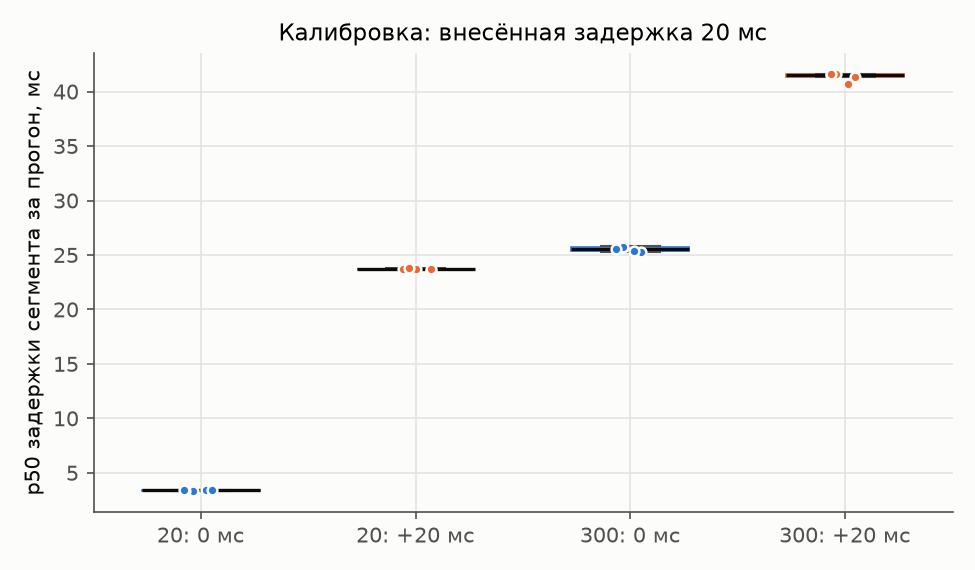
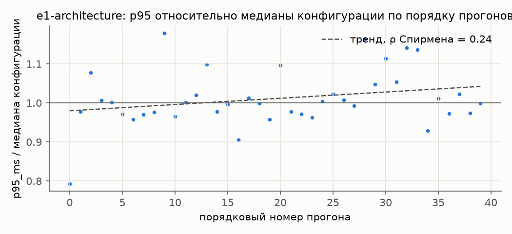
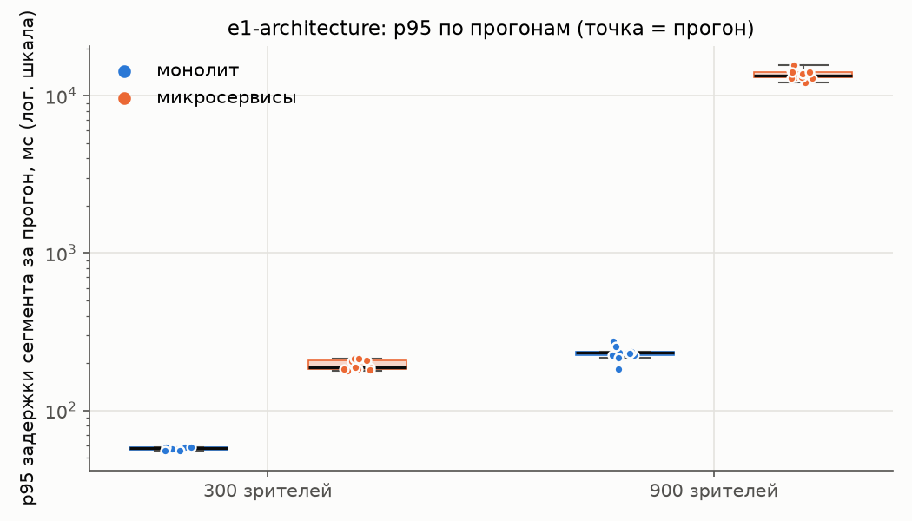
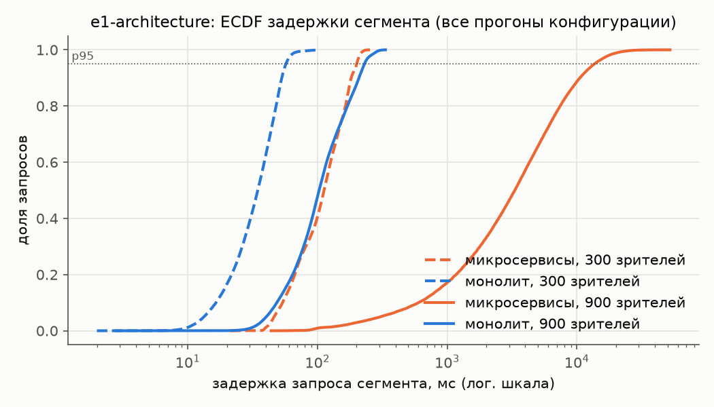
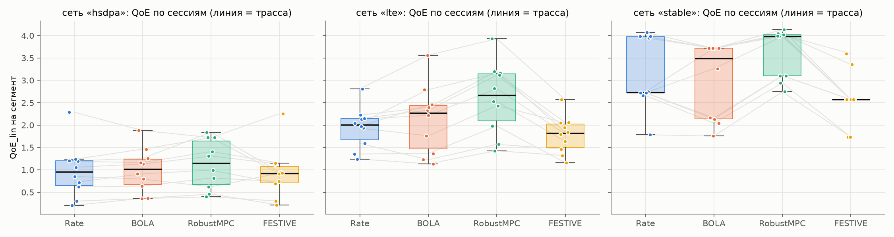
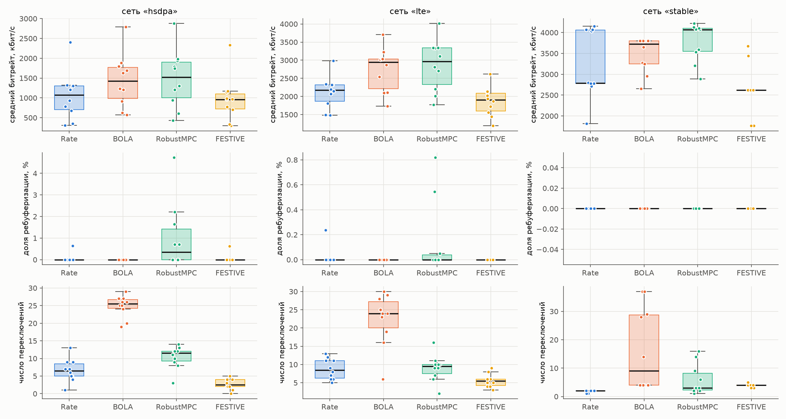
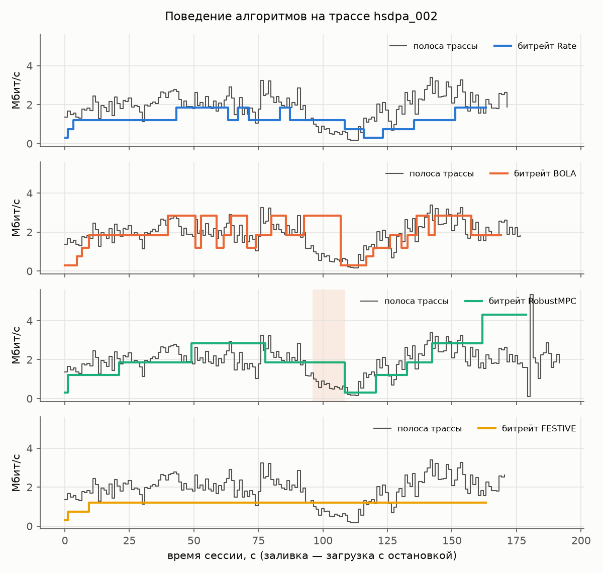
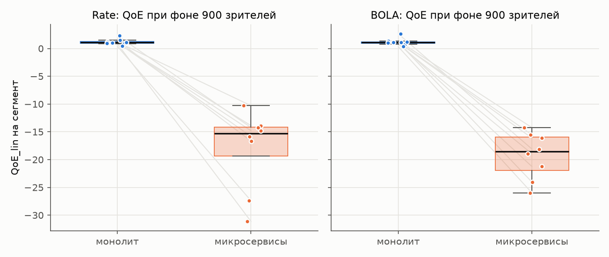

<div class="title-page" align="center">
<p class="tp-org">Министерство науки и высшего образования Российской Федерации<br>федеральное государственное автономное образовательное учреждение высшего образования<br><strong>«Национальный исследовательский университет ИТМО»</strong></p>
<div class="tp-center">
<h1>ОТЧЁТ</h1>
<p>о выполнении задания 4</p>
<p class="tp-topic">«Реализация, тестирование и оценка<br>экспериментального стенда»</p>
<p class="tp-parts">Стенд «Платформа потокового видео MPEG-DASH»<br>для двух выпускных квалификационных работ</p>
</div>
<p class="tp-authors">Выполнили:<br>Голиенко Роман<br>Митенева София</p>
<p class="tp-city">Санкт-Петербург<br>2026</p>
</div>

<!-- web-only -->
> Версия для печати: [otchet-zadanie-4.pdf](otchet-zadanie-4.pdf) (все ссылки в файле кликабельны).
> Проект стенда, анализ статей и гипотезы — в отчёте по заданию 3: [pr3-report.md](pr3-report.md).
<!-- /web-only -->

## Введение

В задании 3 по практике двух предметных областей был спроектирован экспериментальный стенд «Платформа потокового видео MPEG-DASH» для двух выпускных квалификационных работ: о сравнении веб-архитектур для высоконагруженных систем (Голиенко Р.) и об алгоритмах адаптации битрейта в потоковом видео (Митенева С.).

**Цель работы** — реализовать спроектированный стенд как воспроизводимый артефакт, проверить корректность самого стенда, провести эксперимент и оценить результаты в сравнении с проанализированными статьями.

Задачи:

1. реализовать все компоненты стенда в Docker Compose с зафиксированными версиями и запуском одной командой;
2. вынести параметры в конфигурационные файлы и сохранять для каждого прогона сырые данные и манифест;
3. проверить стенд: smoke-тест, A/A-тесты, загрузку генератора, калибровку на известном результате, стабильность во времени, повторяемость и работу на второй машине;
4. провести эксперименты E1, E2, E3 и проверить гипотезы со статистикой и размерами эффекта;
5. сравнить результаты со статьями, оценить реализовавшиеся угрозы валидности и наметить развитие стенда для ВКР.

Стенд и все данные — в публичном репозитории <https://github.com/SolarVonBro/streaming-research-stand>. Номера источников в квадратных скобках — по списку литературы (он совпадает со списком отчёта по заданию 3).

## 1. Вопросы, гипотезы и изменения проекта

### 1.1. Напоминание (по отчёту ПР3)

Стенд «Платформа потокового видео MPEG-DASH» отвечает на три вопроса (подробно — разделы 5.1–5.3 отчёта по заданию 3).

- **E1** (ВКР Голиенко Р.): как архитектура сервера — модульный монолит или микросервисы за API-шлюзом — при одинаковом бюджете CPU и памяти влияет на задержку выдачи сегментов. H1₀: p95 задержки (по прогонам) не зависит от архитектуры; H1₁: у микросервисов p95 выше, и разница растёт с нагрузкой. Практически значимо: разность медиан ≥ 10 % и |δ Клиффа| ≥ 0,474.
- **E2** (ВКР Митеневой С.): как алгоритм адаптации битрейта (rate, BOLA, RobustMPC, FESTIVE) влияет на QoE в стабильной, 3G- и 4G-сети. H2₀: QoE четырёх алгоритмов на одних трассах одинаков; H2₁: (а) RobustMPC выше rate на 3G, (б) у BOLA меньше ребуферизации, чем у rate, в нестабильных сетях, (в) FESTIVE переключается реже rate, (г) в стабильной сети различия QoE меньше 10 %.
- **E3** (совместный): ухудшает ли архитектура сервера под высокой нагрузкой QoE зрителей. H3₀: QoE плееров одинаков при монолите и микросервисах; H3₁: при микросервисах ниже.

### 1.2. Изменения по сравнению с проектом

Исследовательские вопросы, гипотезы, факторы, уровни, число повторений и методы анализа не менялись. Изменения касаются реализации и найдены проверкой самого стенда (подробно — раздел 9 «Отладка»):

*Таблица 1 — Изменения по сравнению с ПР3*

| Что изменено | Было в проекте | Стало | Причина |
|---|---|---|---|
| Ресурсы шлюза nginx | 0,25 CPU, 1 рабочий процесс, 64 МБ | 0,5 CPU, 2 процесса, 256 МБ в обоих вариантах | Пилот: при 900–1200 зрителях узким местом монолита был общий шлюз (до 92 % квоты), при 1800 зрителях nginx остановлен по нехватке памяти. Без изменения E1 сравнивал бы шлюз, а не архитектуру приложения |
| Проверки здоровья контейнеров | раз в 2 с | раз в 1 с только при старте, затем раз в 30 с | Первый прогон в CI: каждая проверка запускала процесс Python внутри контейнера и вызывала троттлинг маленьких квот микросервисов — артефакт против одного варианта |
| Keep-alive uvicorn | 5 с по умолчанию | 75 с (больше, чем 60 с у nginx) | Гонка закрытия соединений давала ложные ответы 502 |
| Ошибки запросов Locust | завершали прогон с ошибкой | учитываются как метрика «доля ошибок» | Одна ошибка запроса не должна выбрасывать прогон из анализа |
| Проверка генератора | максимум `docker stats` | без первых 5 с жизни контейнера; приводятся среднее и максимум | Первый замер попадал на запуск интерпретатора, а не на работу |
| Серверные метрики | только метрики приложения по умолчанию | добавлена гистограмма времени проверки токена с мелкими корзинами | Нужно разложение задержки: какая её часть приходится на внутренний вызов `auth` |
| Источник uv в образах | образ `ghcr.io/astral-sh/uv` | пакет `uv==0.5.11` из PyPI | Сборка на ПК падала с 403 от ghcr.io из-за чужих сохранённых учётных данных |
| Проверка на второй машине | рабочий ПК (упомянут в проекте) | конфигурации `configs/local/` с лимитами ×0,25 | Docker на ПК ограничен 1 CPU и 2 ГБ |
| Повторяемость | повторный запуск `make experiment` | второй полный запуск того же коммита на других машинах раннеров | Строже, чем повтор на той же машине |

## 2. Реализация стенда

### 2.1. Диаграмма и компоненты

Диаграмма компонентов хранится в репозитории как код ([docs/architecture.mmd](architecture.mmd)) и приведена на рисунке 1.



*Рисунок 1 — Компонентная диаграмма стенда*

*Таблица 2 — Компоненты и версии*

| Компонент | Реализация | Версия, образ |
|---|---|---|
| Объект исследования streamhub | `sut/app`: FastAPI-приложение из четырёх модулей (`auth`, `catalog`, `delivery`, `telemetry`); роль задаётся переменной `ROLE` | Python 3.12.8 (`python:3.12.8-slim-bookworm@sha256:2199a628…`), uv 0.5.11, зависимости по `sut/uv.lock`: FastAPI 0.163.2, Starlette 1.10.0, uvicorn 0.54.0 + uvloop 0.23.0 + httptools 0.9.0, redis-py 8.1.0, httpx 0.28.1, prometheus-fastapi-instrumentator 8.1.0 |
| Вход / API-шлюз | `gateway/mono.conf`, `gateway/micro.conf` | nginx 1.27.3 (`nginx:1.27.3-alpine@sha256:814a8e88…`) |
| Хранилище | сессии (TTL 1 ч) и поток событий телеметрии | Redis 7.4.1 (`redis:7.4.1-alpine@sha256:c1e88455…`), без записи на диск |
| Нагрузка E1, фон E3 | `load/locustfile.py`: зритель создаёт сессию, получает манифест и раз в 4 с запрашивает сегмент уровня 750 кбит/с и шлёт событие | Locust 2.31.5 (`locustio/locust:2.31.5@sha256:d9f2fe88…`) |
| Эмулятор плееров | `players/player`: `shaper.py` — канал по трассе, `abr.py` — четыре алгоритма, `session.py` — цикл плеера и буфер, `run.py` — группа плееров на одной трассе | Python 3.12.8, httpx 0.28.1, numpy — по `players/uv.lock` |
| Наблюдение | `monitoring/prometheus.yml` | Prometheus 2.54.1, cAdvisor 0.49.1, Grafana 11.2.0 (по желанию) — все по digest |
| Раннер | `runner/run_experiment.py`, `runner/smoke.py` | окружение хоста по `uv.lock` |
| Анализ | `analysis/analyze.py`, `analysis/stats.py` | pandas, SciPy, matplotlib по `uv.lock` |

Ключевые решения реализации:

- **Один код в двух архитектурах.** Модули бизнес-логики одинаковы; различается только способ проверки токена при выдаче сегмента: в монолите — вызов функции в том же процессе, в микросервисах — HTTP-вызов `GET /internal/verify` сервиса `auth` с пулом постоянных соединений. Внутренний адрес закрыт на шлюзе в обоих вариантах.
- **Содержимое сегментов** — детерминированные байты (генератор с фиксированным сидом), размеры — точно как у 48 сегментов шести уровней видео Envivio из артефакта Pensieve [10]. Манифест MPD собирается из этих размеров.
- **Эмуляция канала** выполнена на стороне клиента: байты ответа считаются доставленными не раньше, чем их успел бы передать канал с пропускной способностью трассы, плюс RTT 80 мс; если сервер отдаёт медленнее, ёмкость канала за это время теряется. Так задержка сервера честно попадает в измеренную плеером пропускную способность (основа E3).
- **Алгоритмы:** rate — гармоническое среднее 5 замеров × 0,9 (как ThroughputRule в dash.js и Sabre [12]); BOLA-BASIC — полезность ln(S_m/S_1), γp = 5 с, V·p = (B_max − p)/(υ_M + γp) по [9] и Sabre; RobustMPC — горизонт 5, прогноз = гармоническое среднее / (1 + максимальная ошибка), QoE_lin с μ = 4,3 по [8] и эталонному коду [10]; FESTIVE — гармоническое среднее 20 замеров, повышение на один уровень после k сегментов на уровне k, отложенное обновление (2ⁿ + 1, α = 12) и рандомизированный буфер по [11]. Все отклонения от первоисточников описаны в докстрингах `abr.py` и в разделе 7.
- **Пересоздание объекта и Redis перед каждым прогоном** (`docker compose up --force-recreate --wait`): кэши, сессии и состояние процессов не переходят между прогонами. Решение обратное «тёплому» стенду: в ВКР сравниваются архитектуры в установившемся режиме после прогрева, а не накопленное состояние.

### 2.2. Ограничения ресурсов

*Таблица 3 — Лимиты контейнеров по умолчанию (раннер GitHub Actions, 4 vCPU / 16 ГБ)*

| Контейнер | CPU | Память |
|---|---|---|
| edge / API-шлюз | 0,25 | 64 МБ |
| mono: приложение (2 процесса uvicorn) | 1,75 | 512 МБ |
| micro: auth / catalog / delivery / telemetry (по 1 процессу) | 0,5 / 0,15 / 0,75 / 0,35 | по 128 МБ |
| Redis | 0,5 | 256 МБ |
| Locust / players | 1,0 / 0,5 | 512 / 256 МБ |
| Prometheus / cAdvisor | 0,25 / 0,25 | 256 / 192 МБ |

Лимиты задаются переменными окружения с порядком приоритета «значения по умолчанию < раздел `resources` конфигурации < переменные окружения». В манифест прогона пишутся и заявленные лимиты, и фактически применённые Docker (`docker inspect`: `NanoCpus`, `Memory`), так что проверяющий видит, на каком окружении выполнен каждый прогон.

## 3. Инструкция воспроизведения

Полная инструкция — в [README](../README.md). Кратко:

```bash
git clone https://github.com/SolarVonBro/streaming-research-stand.git && cd streaming-research-stand
git checkout v1.0.0
make setup && make test && make smoke     # окружение, тесты, smoke-тест
make experiment                           # A/A, калибровка, E1, E2, E3 (~6 ч на 4 vCPU)
make analyze                              # results/processed/summary.md, results/figures/
```

Без локального Docker то же самое выполняется в GitHub Actions: вкладка Actions → experiment → Run workflow (`which: all`). Каждый блок экспериментов идёт на отдельной машине раннера вместе со своим A/A-тестом; задание `analyze` собирает сырые данные всех блоков, строит таблицы и графики и публикует архив `raw-data.tar.gz` с контрольной суммой SHA-256.

Сценарий проверки на практике выполнен трижды «с нуля»: два полных запуска на чистых машинах GitHub Actions (<https://github.com/SolarVonBro/streaming-research-stand/actions/runs/44346188871> и <https://github.com/SolarVonBro/streaming-research-stand/actions/runs/44347411987>) и сокращённый — на рабочем компьютере с Windows и Docker Desktop (разделы 4.6–4.7). Калибровка в итоговой версии — <https://github.com/SolarVonBro/streaming-research-stand/actions/runs/44367731170>. Сырые данные всех запусков с контрольными суммами SHA-256 опубликованы в релизе <https://github.com/SolarVonBro/streaming-research-stand/releases/tag/v1.0.0>; чтобы пересчитать таблицы и графики без повторения эксперимента, достаточно распаковать архив в `results/` и выполнить `make analyze`.

Как проверяющий узнает, что его прогон выполнен на том же окружении: в `manifest.json` каждого прогона записаны коммит и признак незакоммиченных изменений, digest всех образов, заявленные и фактически применённые лимиты контейнеров, модель процессора, число ядер, ядро ОС, версии Docker и Compose, идентификатор и версия образа раннера CI. Достаточно сравнить эти поля со своими.

## 4. Тестирование стенда

Перед основным экспериментом и вместе с ним стенд проверяется по пяти направлениям. Проверки E1 и E2 выполнены на той же машине и в том же задании CI, что и основной эксперимент соответствующего блока.

### 4.1. Smoke-тест

`make smoke` поднимает сначала монолит, затем микросервисы и проверяет 10 пунктов для каждого варианта: ответ шлюза, создание сессии, манифест с шестью уровнями, выдачу сегмента высшего уровня (> 1 МБ), побайтную детерминированность сегмента, отказ без токена и с чужим токеном (401), приём телеметрии, закрытый снаружи внутренний адрес `/internal/` (404), метрики Prometheus в сервисе. Отдельно проверяется, что Prometheus собирает cAdvisor. Smoke-тест выполняется в каждом задании CI перед экспериментом и прошёл во всех запусках. На рабочем ПК (Docker Desktop, 1 CPU) он прошёл со всеми 20 проверками при лимитах, уменьшенных в 4 раза.

### 4.2. Калибровка на известном результате

Известный эффект — задержка 20 мс, вносимая в обработчик выдачи сегмента переменной `INJECT_DELAY_MS` (только в калибровке). Стенд откалиброван, если интервал прироста медианы p50 содержит фактическую внесённую задержку. Кроме того, модульный тест эмулятора канала проверяет известное время загрузки: 150 000 байт по каналу 2 Мбит/с с RTT 80 мс — 0,68 с ± 5 % (раздел 9, ошибка 3).

Калибровка выполнялась трижды, и каждая следующая версия отвечала на вопрос, оставленный предыдущей.

*Таблица 4 — Калибровка: прирост медианы p50 задержки сегмента (5 + 5 прогонов на уровень)*

| Версия | Нагрузка | Прирост p50, мс [95 % ДИ] | Фактическая задержка на сервере, мс | Итог |
|---|---|---|---|---|
| 1: `asyncio.sleep(0.02)` (запуски 1 и 2) | 300 зрителей | 13,2 [10,5; 13,8] и 12,6 [11,8; 14,5] | не измерялась | не откалиброван: сдвиг одинаков на всех перцентилях (12–13 мс) |
| 2: досыпание по реальным часам | 300 зрителей | 15,3 [14,6; 16,6] | 21,0 | источник исправлен, но прирост меньше задержки |
| 3: то же, два уровня нагрузки | **20 зрителей** | **20,3 [20,1; 20,4]** | **20,5** | **откалиброван: ошибка < 0,4 мс, сдвиг одинаков на 1-м, 10-м, 50-м и 90-м перцентилях** |
| 3 | 300 зрителей | 15,9 [15,1; 16,3] | 21,0 | сквозная задержка под нагрузкой неаддитивна |

Первая версия показала, что неточен сам источник эффекта. Таймеры uvloop (libuv) отсчитываются от времени, закэшированного в начале итерации событийного цикла; под нагрузкой итерация длится миллисекунды, и `asyncio.sleep(0.02)` срабатывает раньше. Во второй версии задержка досыпается по реальным часам и записывается в гистограмму — она стала 21,0 мс, но клиент по-прежнему видел меньше. Третья версия разделила две причины: без очередей (20 зрителей) клиент видит ровно внесённую задержку, то есть измерительная цепочка точна. При 300 зрителях часть исходной задержки — ожидание своей очереди в общем событийном цикле рабочего процесса, и пауза обработчика это ожидание перекрывает: пока один запрос «спит», процесс обслуживает другие. Это свойство системы с очередью, а не ошибка измерения, и оно важно для интерпретации E1: разность задержек под нагрузкой нельзя напрямую переводить в «лишние миллисекунды работы сервера».



*Рисунок 2 — Калибровка: p50 задержки сегмента без внесённой задержки и с ней при 20 и 300 зрителях*

### 4.3. A/A-тесты и шум стенда

**A/A для E1.** Десять прогонов одной конфигурации (монолит, 900 зрителей) в случайном порядке, с пересозданием контейнеров перед каждым.

*Таблица 5 — A/A-тест E1*

| Показатель | Значение |
|---|---|
| Медиана p95, мс | 221 (IQR 30) |
| Коэффициент вариации p95 между прогонами | 11,5 % |
| Случайное разбиение 5 + 5: медианы групп | 215 и 229 мс |
| Тест Манна–Уитни, p | 1,00 |
| δ Клиффа | +0,04 (пренебрежимый) |
| Доля значимых (p < 0,05) среди всех 252 разбиений | 3,2 % (ожидается около 5 %) |
| MDE при плане 10 + 10 прогонов (мощность 80 %, α = 0,05) | 16,7 % |

Значимой разницы между «одинаковыми» группами нет, доля ложных срабатываний не превышает номинальные 5 %, то есть тест на этом стенде не «видит» эффект там, где его нет. Шум стенда — около 11,5 % по p95 между прогонами. Отсюда минимальный обнаружимый эффект: 16,7 % при 10 + 10 прогонах. Это больше порога практической значимости из ПР3 (10 %): эффект в 10–16 % на этом стенде надёжно не обнаружить, для этого нужно около 25–30 прогонов на конфигурацию или менее шумная машина. Для основного вывода E1 это не важно — наблюдаемые эффекты (226 % и 5 710 %) на порядки больше MDE, — но в ВКР план нужно рассчитывать от измеренного шума.

**A/A для E2.** В каждом из 10 прогонов два одинаковых плеера BOLA проигрывают видео по одной и той же трассе 3G. Сравниваются «близнецы» внутри прогона и прогоны между собой.

*Таблица 6 — A/A-тест E2*

| Показатель | Запуск 1 | Запуск 2 |
|---|---|---|
| QoE, медиана (близнец 1 / близнец 2) | 0,880 / 0,899 | 0,899 / 0,899 |
| Медиана разности близнецов; тест Уилкоксона | 0,019; p = 0,016 | 0; все 10 прогонов одинаковы |
| Битрейт, ребуферизация, число переключений у близнецов | совпадают (1 270 кбит/с, 0 %, 24) | совпадают |
| Разброс QoE между прогонами (IQR) | 0,019 | 0 |
| Случайное разбиение 5 + 5: p (Манн–Уитни), δ Клиффа | 1,00; 0,00 | все значения равны |
| MDE парного сравнения на 10 трассах | 0,028 QoE | ≈ 0 |

Эмуляция по трассе почти детерминирована: во втором запуске все 20 сессий дали одинаковый QoE, в первом разброс не превысил 0,02. Но в первом запуске второй «близнец» систематически получал чуть больший QoE — на 0,019 (≈ 2 %), p = 0,016. Битрейт, остановки и число переключений у близнецов одинаковы, то есть различие — в последовательности решений: из-за разницы во времени в миллисекунды один из плееров иногда принимает другое решение. На второй машине эффект не повторился, значит, он зависит от джиттера времени конкретной машины, а не от алгоритма. В E2 порядок плееров в прогоне фиксирован (rate, BOLA, RobustMPC, FESTIVE), поэтому смещение до 0,02 QoE возможно и там. Это меньше всех значимых различий E2 (0,2–1,1), но сравнимо с незначимой разностью BOLA − rate на 3G (0,06). Мера для ВКР — перемешивать порядок плееров в каждом прогоне (раздел 7).

### 4.4. Генератор нагрузки не является узким местом

Загрузка CPU генератора считается по `docker stats` без первых 5 с жизни контейнера (запуск интерпретатора) и относится к его лимиту.

*Таблица 7 — Максимальная загрузка CPU генератора за прогон, доля его лимита (медиана по прогонам / максимум)*

| Эксперимент | Генератор (лимит) | Запуск 1 | Запуск 2 |
|---|---|---|---|
| A/A E1 | Locust (1,0 CPU) | 0,24 / 0,26 | 0,24 / 0,25 |
| Калибровка E1 | Locust (1,0 CPU) | 0,07 / 0,08 | — |
| E1 | Locust (1,0 CPU) | 0,17 / 0,33 | 0,16 / 0,26 |
| A/A E2 | эмулятор плееров (0,5 CPU) | 0,03 / 0,04 | 0,03 / 0,03 |
| E2 | эмулятор плееров (0,5 CPU) | 0,05 / 0,07 | 0,05 / 0,06 |
| E3 | эмулятор плееров (0,5 CPU) | 0,03 / 0,04 | 0,02 / 0,04 |
| E3, фон | Locust (1,0 CPU), монолит / микросервисы | max 0,36 / 0,77 | max 0,26 / 0,65 |

Порог 0,8 не превышен ни в одном прогоне на раннере. Эмулятор плееров сам измеряет свою долю ядра: 1,3–1,6 % в медиане, не больше 2,2 %. Ближе всего к порогу фоновый Locust в E3 при микросервисах (0,77): когда сервер не отвечает секундами, у генератора копятся открытые соединения и повторные попытки. Для E3 это не опасно — там измеряют плееры, а не Locust, — но для более сильной перегрузки генератору нужна отдельная машина. На рабочем ПК (раздел 4.7) генератор упирался в квоту, и проверка это показала.

### 4.5. Стабильность во времени

Для каждого эксперимента метрика прогона нормируется на медиану своей конфигурации и сопоставляется с порядковым номером прогона (коэффициент корреляции Спирмена). Систематический дрейф — нагрев, накопление состояния, фоновые процессы машины — дал бы значимую корреляцию.

*Таблица 8 — Тренд метрики по порядку прогонов (ρ Спирмена, p)*

| Эксперимент | Метрика | Запуск 1 | Запуск 2 |
|---|---|---|---|
| A/A E1 | p95 | 0,19 (p = 0,60) | −0,07 (p = 0,86) |
| E1 | p95 | 0,24 (p = 0,13) | −0,08 (p = 0,64) |
| A/A E2 | QoE | 0,07 (p = 0,78) | значения не менялись |
| E2 | QoE | −0,03 (p = 0,75) | −0,02 (p = 0,84) |
| E3 | QoE | −0,26 (p = 0,13) | 0,05 (p = 0,76) |
| Калибровка (первая версия) | p50 | 0,53 (p = 0,12) | — |

Значимого тренда нет ни в одном эксперименте: нагрев машины, накопление состояния и фоновые процессы раннера не сдвигают метрику от первого прогона к последнему. Пересоздание контейнеров перед каждым прогоном и рандомизация порядка работают. Графики «метрика по порядковому номеру» — `results/figures/*_stability.png`.



*Рисунок 3 — E1: p95 прогона относительно медианы своей конфигурации по порядку прогонов*

### 4.6. Повторяемость

Полный эксперимент того же коммита (`435c07c`) запущен дважды независимо, на разных машинах раннеров с одинаковой моделью процессора (Intel Xeon Platinum 8573C). Это строже, чем повтор на той же машине: проверяется и повторяемость, и воспроизводимость на «чужом» экземпляре того же окружения. Сравнение выводов делает скрипт `analysis/compare_runs.py`, полный результат — в `results/processed/repeatability.md`.

*Таблица 9 — E1 в двух независимых запусках (медиана по 10 прогонам)*

| Нагрузка | Архитектура | p95, мс (запуск 1) | p95, мс (запуск 2) | Запросов/с (1 / 2) | δ Клиффа (1 / 2) | p Холма (1 / 2) |
|---|---|---|---|---|---|---|
| 300 | монолит | 57,3 | 56,1 | 150 / 150 | | |
| 300 | микросервисы | 187 | 221 | 150 / 150 | +1,00 / +1,00 | 0,0004 / 0,0004 |
| 900 | монолит | 232 | 180 | 450 / 450 | | |
| 900 | микросервисы | 13 476 | 15 777 | 331 / 303 | +1,00 / +1,00 | 0,0004 / 0,0004 |

*Таблица 10 — E2 и E3 в двух независимых запусках*

| Эксперимент | Запуск 1 | Запуск 2 |
|---|---|---|
| E2, медианный QoE rate / BOLA / RobustMPC / FESTIVE, 3G | 0,955 / 1,02 / 1,15 / 0,92 | 0,962 / 1,02 / 1,24 / 0,924 |
| E2, то же, 4G | 2,01 / 2,28 / 2,67 / 1,82 | 2,01 / 2,28 / 2,66 / 1,80 |
| E2, то же, стабильная сеть | 2,73 / 3,49 / 3,99 / 2,57 | 2,74 / 3,49 / 3,95 / 2,57 |
| E2, p Фридмана: стабильная / 3G / 4G | 2·10⁻⁵ / 0,045 / 0,0005 | 2·10⁻⁵ / 0,045 / 0,011 |
| E3, QoE rate: монолит → микросервисы | 1,08 → −15,3 | 1,03 → −9,45 |
| E3, δ Клиффа; p Холма | −1,00; 0,016 | −1,00; 0,004 |

В E2 медианы QoE совпали до сотых, а порядок алгоритмов — во всех трёх профилях: эмуляция по трассам почти детерминирована, и от машины зависит только задержка сервера (миллисекунды), которая на загрузку сегментов по каналу почти не влияет. В E3 вывод тот же, но величина падения QoE зависит от того, насколько перегружен микросервисный вариант на конкретной машине.

Выводы совпали полностью: направление эффектов, их величина по δ Клиффа и решения о значимости после поправки Холма одинаковы. Абсолютные значения монолита совпали в пределах шума A/A-теста (при 300 зрителях — 57 и 56 мс). Микросервисы на втором экземпляре машины оказались медленнее (221 против 187 мс), то есть их задержка сильнее зависит от конкретной машины. Это объяснимо: у них насыщен один сервис с долей 0,75 CPU, и любое снижение производительности ядра у облачной машины сразу удлиняет его очередь. Тот же вывод о повышенной нестабильности нагрузочных тестов микросервисов сделан в [5]. Для ВКР это означает, что абсолютные числа микросервисного варианта нужно приводить с разбросом между машинами, а не по одному запуску.

### 4.7. Проверка на второй машине

Вторая машина — рабочий компьютер исполнителя: AMD Ryzen 5 5500U, Windows 10, Docker Desktop 28.3.2, виртуальной машине WSL 2 выделены 1 CPU и 2 ГБ. Это в 4 раза меньше ядер, чем у раннера, поэтому лимиты контейнеров и число зрителей уменьшены в 4 раза (`configs/local/`), повторений — 5 (весь прогон должен был уложиться в полтора часа и не мешать работе компьютера). Во время прогонов работал сторож памяти: при резерве памяти Windows меньше 1,5 ГБ он остановил бы стенд. Минимальный резерв за время замеров — 4,4 ГБ, сторож не срабатывал. Все 25 прогонов успешны.

*Таблица 11 — E1 на рабочем ПК (1 CPU, лимиты ×0,25), медиана по 5 прогонам*

| Нагрузка | Архитектура | p50, мс | p95, мс | Запросов/с | Генератор, макс. доля лимита |
|---|---|---|---|---|---|
| 75 зрителей | монолит | 54 | 175 | 35 | 0,19–0,86 |
| 75 зрителей | микросервисы | 258 | 704 | 36 | 0,25–0,47 |
| 225 зрителей | монолит | 200 | 1 200 | 105 | **0,84–1,01** |
| 225 зрителей | микросервисы | 9 010 | 26 000 | 45 | 0,37–0,85 |

Что показала вторая машина:

- **Направление эффекта то же:** микросервисы медленнее при обеих нагрузках, разрыв растёт с нагрузкой (отношение медиан p95 — 4,0 и 21,7). При 225 зрителях различие значимо (δ = +1, p Холма = 0,016). При 75 зрителях δ = +0,6, но после поправки p = 0,15: при n = 5 один выброс монолита (первый прогон, p95 = 1049 мс) снижает мощность теста.
- **Абсолютные значения хуже, чем при простом масштабировании:** при вчетверо меньших ресурсах и нагрузке p95 монолита выросла с 57 до 175 мс (в 3 раза), микросервисов — со 187 до 704 мс (в 3,8 раза). Постоянные затраты не масштабируются вместе с квотой: запуск интерпретаторов, служебные проверки, сбор метрик. У микросервисов таких процессов пять, поэтому они страдают сильнее.
- **Генератор стал узким местом,** и проверка это поймала. При 225 зрителях Locust с квотой 0,25 CPU превысил 80 % лимита во всех 5 прогонах монолита (а всего — в 7 прогонах из 20) (монолит обслуживал 105 запросов/с, и генератору приходилось их создавать). Задержки монолита в этих прогонах — оценка сверху. Вывод о направлении эффекта от этого не меняется: у микросервисов генератор был ниже порога в 4 прогонах из 5, а p95 всё равно в 20 раз выше. Урок для ВКР: на слабой машине генератору нужна доля CPU больше пропорциональной.
- **E2 на второй машине** (5 трасс HSDPA): медианный QoE — RobustMPC 1,64, rate 1,19, BOLA 1,13, FESTIVE 0,95; остановок нет ни у одного алгоритма; BOLA переключается чаще всех (28 раз за видео против 4–10 у остальных). На пяти трассах тест Фридмана различий не находит (p = 0,32). Порядок по медиане совпал с основным запуском частично: RobustMPC — первый, FESTIVE — последний, а rate и BOLA поменялись местами. Трассы на ПК — другая выборка из 5 файлов (сид тот же, размер выборки другой), поэтому сравнимы только распределения, а не отдельные трассы; для такого сравнения в ВКР выборку для второй машины нужно брать как подмножество основной. Генератор — не выше 34 % лимита.
- Тренда по порядку прогонов нет: ρ = −0,19 (p = 0,42) для E1 и ρ = 0,07 (p = 0,76) для E2.

Ответ на вопрос задания «какие результаты будут на машине с вдвое меньшим числом ядер и почему»: абсолютные задержки вырастут сильнее, чем пропорционально (постоянные затраты процессов не делятся на ядра), разрыв между архитектурами увеличится (у микросервисов больше процессов с постоянными затратами и мельче доли CPU), а при той же нагрузке быстрее наступит насыщение — и самого объекта, и генератора. Направление выводов сохранится.

## 5. Результаты эксперимента

### 5.1. E1: архитектура сервера под нагрузкой

Основной запуск — машина раннера GitHub Actions (Intel Xeon Platinum 8573C, 4 vCPU, 16 ГБ, Ubuntu 24.04, Docker 28.0.4), 40 прогонов в случайном порядке, по 10 на конфигурацию. Все прогоны успешны, ошибок запросов нет.

*Таблица 12 — E1: задержка выдачи сегмента и ресурсы (медиана по 10 прогонам, в скобках — 95 % bootstrap-интервал медианы)*

| Нагрузка | Архитектура | p50, мс | p95, мс | p99, мс | Запросов/с | CPU объекта, ядер |
|---|---|---|---|---|---|---|
| 300 зрителей | монолит | 34,5 | 57,3 [56,1; 58,0] | 65,4 | 150 | 0,14 |
| 300 зрителей | микросервисы | 105 | 187 [182; 208] | 208 | 150 | 0,32 |
| 900 зрителей | монолит | 102 | 232 [220; 244] | 257 | 450 | 0,43 |
| 900 зрителей | микросервисы | 3 320 | 13 500 [13 014; 14 206] | 20 300 | 331 | 1,07 |

*Таблица 13 — E1: проверка гипотезы H1 (тест Манна–Уитни, двусторонний, поправка Холма)*

| Нагрузка | Δ медиан p95, мс | 95 % ДИ Δ | Δ, % | Отношение micro/mono | δ Клиффа | p (Холм) |
|---|---|---|---|---|---|---|
| 300 зрителей | +130 | [+124; +151] | +226 % | 3,26 [3,16; 3,66] | +1,00 (большой) | 0,0004 |
| 900 зрителей | +13 200 | [+12 781; +14 082] | +5 710 % | 58,1 [55,4; 62,9] | +1,00 (большой) | 0,0004 |

**Гипотеза H1₁ подтверждена.** На обоих уровнях нагрузки p95 микросервисного варианта выше: каждый из 10 прогонов микросервисов медленнее каждого прогона монолита (δ = +1), разница многократно превышает порог практической значимости (10 %) и минимальный обнаружимый эффект стенда (16,7 %, раздел 4.3). Разница растёт с нагрузкой: отношение медиан p95 увеличивается с 3,3 до 58 раз, интервалы не пересекаются. При 900 зрителях микросервисный вариант не справляется с заданной интенсивностью: 331 запрос/с вместо 450, то есть очередь растёт в течение всего прогона.

**Где теряется время.** Разложение по серверным гистограммам (таблица ниже) показывает, что почти вся задержка обработчика выдачи у микросервисов — это внутренний вызов `auth`.

*Таблица 14 — Разложение задержки на стороне сервера (медиана по прогонам, мс)*

| Нагрузка | Архитектура | Обработчик выдачи, p50 | Обработчик выдачи, p95 | Проверка токена, p50 | Проверка токена, p95 |
|---|---|---|---|---|---|
| 300 | монолит | 5,3 | 10,0 | 3,6 | 12,1 |
| 300 | микросервисы | 87,9 | 231 | 87,5 | 187 |
| 900 | монолит | 7,0 | 24,3 | 7,9 | 28,5 |
| 900 | микросервисы | 2 900 | 17 400 | ≥ 1 000 | ≥ 1 000 |

Загрузка контейнеров (доля своей квоты CPU, медиана по прогонам) объясняет механизм: при 900 зрителях `delivery` занят на 98 % своих 0,75 CPU, а `auth` — на 17 %, `telemetry` — на 25 %, `catalog` — на 3 %. Монолит при той же нагрузке использует 15 % своих 1,75 CPU. Микросервисы тратят на ту же работу в 2,3–2,5 раза больше CPU (0,32 против 0,14 ядра при 300 зрителях и 1,07 против 0,43 при 900): на каждый сегмент добавляются сериализация HTTP-запроса и ответа в `delivery` и в `auth`. А общий бюджет разделён на фиксированные доли, и самый нагруженный сервис упирается в свою долю, пока соседи простаивают. Это и есть «фрагментация бюджета CPU» — свойство декомпозиции при фиксированных ресурсах, которого нет у монолита с общим пулом процессов. Диагностика на ПК (`runner/diag_auth.py`) показала, что сама сеть между контейнерами быстрая (p50 1,2 мс через «сырой» сокет), а клиент httpx добавляет к вызову единицы миллисекунд на p50 и десятки — в хвосте; под нагрузкой это время умножается на очередь в событийном цикле `delivery`.



*Рисунок 4 — E1: p95 задержки сегмента по прогонам (логарифмическая шкала, точка — прогон)*



*Рисунок 5 — E1: эмпирическая функция распределения задержки сегмента (все прогоны конфигурации)*

### 5.2. E2: алгоритмы адаптации битрейта

Тридцать прогонов (3 профиля сети × 10 трасс); в каждом прогоне четыре плеера одновременно проигрывают всё видео (48 сегментов, 192 с) по одной трассе. Сервер — монолит без фоновой нагрузки, его задержка (первый байт за 3–5 мс) на результат не влияет. Все 120 сессий завершены.

*Таблица 15 — E2: медианы по 10 сессиям (QoE_lin на сегмент; битрейт, кбит/с; доля ребуферизации, %; переключений за видео)*

| Сеть | Показатель | rate | BOLA | RobustMPC | FESTIVE |
|---|---|---|---|---|---|
| stable (3–6 Мбит/с) | QoE | 2,73 | 3,49 | **3,99** | 2,57 |
| | битрейт | 2 790 | 3 720 | 4 070 | 2 620 |
| | переключений | 2 | 9 | 3 | 4 |
| hsdpa (3G, ср. 1,6 Мбит/с) | QoE | 0,955 | 1,02 | **1,15** | 0,92 |
| | битрейт | 1 070 | 1 430 | 1 520 | 961 |
| | ребуферизация | 0 | 0 | 0,35 | 0 |
| | переключений | 6,5 | 25,5 | 11,5 | 2,5 |
| lte (4G ÷10, ср. 3,1 Мбит/с) | QoE | 2,01 | 2,28 | **2,67** | 1,82 |
| | битрейт | 2 170 | 2 940 | 2 960 | 1 900 |
| | переключений | 8,5 | 24 | 9,5 | 5,5 |

Начальная задержка у всех алгоритмов одинакова (0,5 с в стабильной сети, 0,9 с в 4G, 1,3–1,4 с в 3G): все начинают с низшего уровня.

*Таблица 16 — E2: проверка гипотез (парные сравнения на 10 трассах, тест Уилкоксона, поправка Холма на 6 пар)*

| Гипотеза | Сеть | Результат | Медиана парной Δ [95 % ДИ] | δ Клиффа | p (Холм) | Вывод |
|---|---|---|---|---|---|---|
| H2₀: QoE четырёх алгоритмов одинаков | stable / hsdpa / lte | тест Фридмана | — | — | p = 2·10⁻⁵ / 0,045 / 0,0005 | H2₀ отвергается во всех профилях (в 3G — на грани) |
| (а) RobustMPC > rate по QoE | hsdpa | +0,235 (+25 %) | [−0,016; +0,369] | +0,22 | 0,80 | направление совпало, но не значимо: **не подтверждена** |
| | lte | +0,651 (+32 %) | [+0,403; +0,977] | +0,54 | 0,016 | подтверждена |
| | stable | +0,332 (+12 %) | [+0,070; +0,959] | +0,56 | 0,012 | подтверждена |
| (б) у BOLA меньше ребуферизации, чем у rate | hsdpa, lte | остановок почти нет: BOLA — 0 сессий с остановкой, rate — по 1 | — | — | — | **не проверяема** на этих трассах |
| (в) FESTIVE переключается реже rate | hsdpa | 2,5 против 6,5 | — | −0,76 | 0,012 | подтверждена |
| | lte | 5,5 против 8,5 | — | −0,66 | p = 0,008 | подтверждена |
| | stable | 4 против 2 | — | +1,00 | p = 0,002 | **опровергнута**: в ровной сети FESTIVE переключается чаще |
| (г) в стабильной сети различия QoE < 10 % | stable | RobustMPC +12 % к rate, FESTIVE −12 % (δ = −0,64, p = 0,012) | — | — | — | **опровергнута** |

Что показал эксперимент:

1. **RobustMPC даёт лучший QoE во всех профилях** — за счёт самого высокого битрейта. Плата — остановки: из 30 сессий RobustMPC 8 имели остановки (против 2 у rate и 0 у BOLA), то есть он чаще переоценивает канал. Именно об этом предупреждали авторы MPC [8]: при ошибке прогноза больше 25 % на HSDPA MPC теряет преимущество.
2. **BOLA (вариант BASIC) получает высокий битрейт без остановок, но переключается в 3–4 раза чаще остальных** (24–26 раз за 48 сегментов в нестабильных сетях). Это известное свойство BOLA-BASIC: решение зависит только от буфера, и вблизи порогов буфера уровень «прыгает». В эталонном плеере dash.js для этого добавлены надстройки BOLA-E и подавление колебаний [12]; в стенде реализован базовый вариант из [9].
3. **FESTIVE консервативен:** самый низкий битрейт и QoE, зато в нестабильных сетях — меньше всего переключений, что и было его целью [11]. Его главные механизмы (справедливость и рандомизация запросов) нужны при конкуренции нескольких плееров за канал, а в нашем плане каждый плеер имеет свой канал, поэтому они себя не проявляют.
4. **Гипотеза (г) опровергнута.** Ожидалось, что в стабильной быстрой сети все алгоритмы сравняются. На деле разница там значимая: rate с запасом 0,9 не берёт уровень 4300 кбит/с, если оценка канала меньше 4,8 Мбит/с, а RobustMPC использует накопленный буфер и выбирает его. Это и есть смысл фальсифицируемости: результат, которого мы не ждали, записан и объяснён.



*Рисунок 6 — E2: QoE сессий по алгоритмам в трёх профилях сети (линия — одна трасса)*



*Рисунок 7 — E2: битрейт, доля ребуферизации и число переключений*



*Рисунок 8 — E2: выбранный битрейт четырёх алгоритмов на одной трассе 3G (серая линия — полоса трассы)*

### 5.3. E3: архитектура сервера и QoE зрителей

Двадцать прогонов (2 архитектуры × 10 трасс 3G HSDPA): на фоне 900 «зрителей» Locust два плеера — rate и BOLA — проигрывают всё видео; на каждой трассе оба варианта архитектуры (парный план).

*Таблица 17 — E3 в двух независимых запусках*

| Показатель | Запуск 1 | Запуск 2 |
|---|---|---|
| Фон: p95 сегмента, монолит / микросервисы | 336 мс / 23,2 с | 223 мс / 14,0 с |
| Фон: запросов/с, монолит / микросервисы | 452 / 207 | 452 / 302 |
| Медианное время до первого байта сегмента у плеера, монолит / микросервисы | 4–5 мс / 5,1–5,3 с | 3 мс / 3,3–3,5 с |
| QoE rate: монолит → микросервисы (медиана парной Δ, 95 % ДИ) | 1,08 → −15,3 (−16,7 [−27,8; −14,9]) | 1,03 → −9,45 (−10,7 [−13,3; −7,7]) |
| QoE BOLA: монолит → микросервисы | 1,12 → −18,5 (−20,2 [−25,1; −16,7]) | 1,01 → −7,21 (−8,0 [−11,2; −5,7]) |
| δ Клиффа (оба алгоритма) | −1,00 | −1,00 |
| p Уилкоксона с поправкой Холма | 0,016 | 0,004 |
| Прерванные сессии (микросервисы) | 2 из 10 трасс (оба плеера) | 0 |
| Доля ребуферизации при микросервисах, rate / BOLA | 91 % / 109 % | 57 % / 44 % |

*Таблица 18 — Составляющие QoE в запуске 2 (медиана по сессиям)*

| Архитектура | Алгоритм | Битрейт, кбит/с | Доля ребуферизации, % | Остановок, с | Переключений | Старт, с |
|---|---|---|---|---|---|---|
| монолит | rate | 1 130 | 0 | 0 | 4,5 | 1,42 |
| монолит | BOLA | 1 495 | 0 | 0 | 27 | 1,37 |
| микросервисы | rate | 300 | 56,7 | 108,8 | 0 | 5,89 |
| микросервисы | BOLA | 323 | 43,7 | 83,8 | 2,5 | 4,65 |

**Гипотеза H3₁ подтверждена в обоих запусках.** При фоновой нагрузке 900 зрителей микросервисный вариант перегружен (раздел 5.1): первый байт сегмента приходит плееру через 3–5 с вместо единиц миллисекунд. Эта задержка больше длительности сегмента (4 с), поэтому буфер не успевает пополняться: оба алгоритма опускаются на нижний уровень 300 кбит/с, суммарная остановка составляет от 44 до 109 % длительности видео (больше 100 % — остановки дольше самого видео; доля считается от длительности видео, как определено в ПР3), старт растягивается до 5–6 с. QoE падает с ≈ 1 до отрицательных значений. Отрицательный QoE означает, что штраф за остановки (4,3 за секунду) перевешивает весь битрейт. В запуске 1 часть зрителей при микросервисах не досмотрела видео: сервер не ответил на сегмент за 5 попыток. Эти сессии исключены из парного сравнения, что делает его консервативным.

Различие между алгоритмами при перегрузке сервера не воспроизвелось: в запуске 2 BOLA потерял меньше, чем rate, а в запуске 1 — больше. Делать вывод об устойчивости буферного алгоритма к задержке сервера нельзя: оба алгоритма упираются в одно и то же — сегменты физически приходят позже, чем проигрываются.

Связь двух тем ВКР: архитектурный выбор, который для сервера выглядит как «рост p95 в 58 раз», для зрителя означает полную потерю качества. При этом алгоритм адаптации, каким бы он ни был, компенсировать перегрузку сервера не может: он управляет только выбором качества, а не временем ответа сервера.



*Рисунок 9 — E3: QoE сессий при фоне 900 зрителей (линия — одна трасса)*

## 6. Оценка результатов и сравнение со статьями

### 6.1. Тема 1: архитектуры

*Таблица 19 — Сопоставление E1 с результатами статей (номера — по списку отчёта ПР3)*

| Работа | Условия | Результат статьи | Наш результат | Совпадение |
|---|---|---|---|---|
| Blinowski et al. [1] | одна машина, лёгкий REST-метод, JMeter | монолит быстрее в 1,37–1,89 раза по пропускной способности | монолит выдерживает 450 запросов/с при p95 232 мс; микросервисы — 331 запрос/с при p95 13,5 с; при 300 зрителях p95 ниже в 3,3 раза | направление совпадает; разрыв у нас больше: на каждый сегмент приходится дополнительный внутренний вызов |
| Blinowski et al. [1] | вычислительно тяжёлый метод | разница не более 5 % | в нашем сценарии тяжёлых запросов нет | не сопоставимо — ограничение сценария |
| Faustino et al. [3] | «болтливые» межсервисные вызовы с сериализацией | задержка выше на 201–6977 % | +226 % при 300 зрителях, +5 710 % при 900 | порядок величин совпадает; механизм тот же — стоимость сетевого вызова на каждый запрос |
| Bjørndal et al. [4] | ёмкость при средней задержке ≤ 200 мс | у монолита в 2,3–4,6 раза больше | у монолита больше не менее чем в 1,36 раза (450 против 331 запроса/с), а фактически сильнее: монолит не насыщен | направление совпадает; точный коэффициент не измерялся (нужен пилот по ступеням с монолитом до насыщения) |
| Чикалева [7] | один хост, 4 конфигурации | время отклика 0,76 с у монолита против 1,07–16 с | p95 57 мс против 187 мс | направление совпадает; абсолютные значения у [7] на порядок больше — там генератор и объект на одной машине без лимитов и 1000 потоков |
| Berry et al. [2] | монолит с 1–12 репликами против микросервисов | микросервисы потребляли меньше CPU и энергии, чем монолит с 12 репликами | микросервисы тратят на ту же работу в 2,3–2,5 раза **больше** CPU | не совпадает. Объяснение: в [2] монолит масштабировался целиком (12 копий всего приложения), а у нас бюджет одинаков и реплик нет; выигрыш [2] — от адресного масштабирования одного сервиса, а не от декомпозиции как таковой |
| Gan et al. [6] | социальная сеть из микросервисов | 36 % времени — сетевая обработка, хвостовая задержка растёт в 3,2 раза из-за очередей | 99 % времени обработчика выдачи — ожидание внутреннего вызова (p50 87,5 из 87,9 мс при 300 зрителях) | механизм совпадает: сетевые вызовы и очереди доминируют в задержке микросервисов |
| Eismann et al. [5] | повторы нагрузочных тестов микросервисов в облаке | для надёжного обнаружения деградации в 10 % нужно около 10 прогонов, результаты между повторами нестабильны | MDE при 10 + 10 прогонах — 16,7–19,5 %; при 300 зрителях p95 микросервисов различается между машинами на 18 %, монолита — на 2 % | совпадает: шум облачного стенда порядка 10 %, микросервисы чувствительнее к окружению |

Главное отличие от статей — величина эффекта при высокой нагрузке (в 58 раз). Она объясняется не самой декомпозицией, а сочетанием трёх условий нашего эксперимента: (1) бюджет CPU разделён на фиксированные доли, и выдача сегментов получила 0,75 CPU, тогда как монолит может отдать ей всё; (2) на каждый сегмент приходится синхронный внутренний HTTP-вызов на Python (клиент httpx заметно дороже вызова функции); (3) при 900 зрителях `delivery` насыщен, и очередь растёт весь прогон. В НИР Голиенко Р. производительность отдельных операций оценена экспертно как «монолит 4, микросервисы 3» [23]. Эксперимент подтверждает направление этой оценки, но показывает, что при фиксированном бюджете и синхронных вызовах разница может быть не «на один балл», а на порядки. Это аргумент за то, чтобы в ВКР оценки шкалы по производительности и масштабируемости опирались на замеры, как и планировалось в НИР.

### 6.2. Тема 2: алгоритмы адаптации

*Таблица 20 — Сопоставление E2 с результатами статей*

| Работа | Результат статьи | Наш результат | Совпадение |
|---|---|---|---|
| Yin et al. [8] | RobustMPC выше не-MPC алгоритмов по медиане нормированного QoE: +15 % на FCC, +10 % на HSDPA | RobustMPC выше rate: +25 % на HSDPA (не значимо при 10 трассах), +32 % на 4G, +12 % в стабильной сети (значимо) | направление и порядок величин совпадают; на HSDPA для значимости нужно больше трасс |
| Yin et al. [8] | при ошибке прогноза > 25 % MPC теряет преимущество; на HSDPA переоценка канала > 20 % времени | у RobustMPC больше всего сессий с остановками (8 из 30) | совпадает: RobustMPC платит остановками за высокий битрейт |
| Mao et al. [10] | RobustMPC — сильнейший из эвристических базовых алгоритмов | RobustMPC лучший по QoE во всех трёх профилях | совпадает |
| Spiteri et al. [12] | BOLA даёт медианный битрейт на 19 % выше THROUGHPUT на 4G | BOLA выше rate на 33–35 % во всех профилях | направление совпадает, эффект больше |
| Spiteri et al. [12] | колебания битрейта у BOLA меньше, чем у THROUGHPUT | у BOLA в 3–4 раза больше переключений | не совпадает. В [12] сравнивалась BOLA-E с подавлением колебаний, у нас — BOLA-BASIC из [9]; колебания BASIC вблизи порогов буфера описаны и в [9], и в НИР Митеневой С. [24] |
| Spiteri et al. [9] | на 3G-трассах доля ребуферизации BOLA — 3,5 % (буфер 25 с) | у BOLA нет остановок ни в одной сессии | порядок совпадает (малые доли); наши трассы мягче: средняя полоса 1,6 Мбит/с, провалы короткие |
| Jiang et al. [11] | FESTIVE повышает стабильность на 50 % ценой эффективности | в нестабильных сетях FESTIVE переключается реже rate в 1,5–2,6 раза, но имеет самый низкий битрейт | совпадает |
| Taraghi et al. [14] | остановки и переключения по-разному влияют на восприятие; одна длинная остановка лучше нескольких коротких | QoE_lin считает остановки линейно; остановки редки, кроме E3 | не проверялось; аргумент за перцептивную модель QoE в ВКР |

**Рекомендации НИР Митеневой С. [24]** — по таблице «условия → алгоритм» — проверены частично. «Нестабильная сеть → BOLA / RobustMPC» подтверждается по QoE: RobustMPC лучший, BOLA без остановок. «Стабильная сеть → MPC / FESTIVE» подтверждается для MPC и не подтверждается для FESTIVE: в одиночном сценарии FESTIVE слишком осторожен. Его преимущество — справедливость при нескольких плеерах на общем канале — в нашем плане не проверялось. «Приоритет плавности → BOLA» не подтверждается для BOLA-BASIC из-за частых переключений.

### 6.3. Совместный вопрос

Статей, которые измеряют QoE зрителей в зависимости от архитектуры сервера, в подборке нет: работы по архитектурам меряют сервер, работы по ABR считают сервер идеальным. E3 показывает, что эти допущения нельзя разделять. Пока сервер не насыщен, его задержка (миллисекунды) ничтожна по сравнению с загрузкой сегмента по сети (секунды), и QoE определяется алгоритмом и каналом. При насыщении задержка сервера становится больше длительности сегмента, и никакой алгоритм это не компенсирует.

## 7. Угрозы валидности и ограничения

*Таблица 21 — Какие угрозы из ПР3 реализовались и как повлияли*

| Угроза (из ПР3) | Что произошло | Влияние на вывод |
|---|---|---|
| Шум облачной машины | CoV p95 между прогонами 10–12 %; вторая машина того же типа дала для микросервисов +18 % к p95 | Направление и значимость не меняются; абсолютные числа микросервисов нужно приводить с разбросом между машинами |
| Распределение CPU между микросервисами | `delivery` насыщен при 98 % квоты, остальные сервисы загружены на 3–25 % | Результат E1 при 900 зрителях отражает конкретное распределение. При другом распределении (больше CPU для `delivery`) разрыв был бы меньше; это проверка для ВКР |
| Отклонения реализаций алгоритмов | BOLA-BASIC колеблется сильнее, чем BOLA-E из dash.js | Выводы о стабильности BOLA относятся к варианту BASIC |
| Эмуляция канала без TCP | Не обнаружено расхождений с калибровкой (0,68 с ± 5 %) | — |
| Синтетика и мягкие трассы | Почти нет остановок в E2 | Гипотеза (б) не проверяема; для ВКР нужны трассы с провалами |
| Генератор на той же машине | На раннере не выше 33 % лимита; на ПК упёрся в квоту в 7 из 20 прогонов (все 5 прогонов монолита при 225 зрителях) | Прогоны ПК с перегруженным генератором дают оценку задержки сверху |

**Новые угрозы, выявленные проверкой стенда:**

- **Позиция плеера внутри прогона** (A/A E2): второй из двух одинаковых плееров получает QoE выше на ≈ 0,02 (2 %, p = 0,016). В E2 алгоритмы всегда стоят в одном порядке (rate, BOLA, RobustMPC, FESTIVE), поэтому на сравнения может накладываться смещение порядка 0,02. Это меньше большинства наблюдаемых различий (0,2–1,1), но сравнимо с разницей BOLA − rate на 3G (0,06). Мера для ВКР: перемешивать порядок плееров в каждом прогоне.
- **Калибровка выявила неаддитивность сквозной задержки под нагрузкой** (раздел 4.2): внесённые на сервере 21 мс видны клиенту как +15 мс при 300 зрителях. Абсолютные разности задержек при нагрузке нельзя переводить в «время работы сервера» один к одному; относительные выводы E1 от этого не зависят.
- **MDE больше порога практической значимости** (16,7–19,5 % против 10 %): эффекты меньше 17 % этот план надёжно не обнаружит.

**Ограничения стенда:** одна машина и один экземпляр каждого сервиса (нет горизонтального масштабирования — главного преимущества микросервисов по НИР); один вид запроса (лёгкая выдача сегмента), нет вычислительно тяжёлых операций; одно видео; качество измеряется битрейтом, а не перцептивной метрикой; Pensieve не реализован.

## 8. Выводы и план развития стенда для ВКР

1. Стенд реализован как воспроизводимый артефакт: все компоненты в Docker Compose с образами по digest и зависимостями по lock-файлам, эксперимент запускается одной командой, параметры вынесены в YAML, каждый прогон сохраняет сырые данные и манифест (коммит, образы, заявленные и фактические лимиты, сиды, машина, время), анализ выполняется скриптом. В CI на каждый push выполняются тесты, smoke-тест и сокращённый эксперимент; полный эксперимент запускается в GitHub Actions вручную.
2. При проверке стенда и анализе найдена 21 ошибка (раздел 9); четыре из них исказили бы результаты, не вызывая сбоев: проверки здоровья, узкий шлюз, гонка keep-alive, неточный источник калибровочной задержки. Калибровка подтвердила точность измерений: без нагрузки внесённые 20,5 мс видны клиенту как 20,3 мс [20,1; 20,4]. A/A-тесты показали шум стенда (CoV 10–12 % по p95) и MDE (17–20 %), генератор нигде на раннере не был узким местом, дрейфа нет, выводы повторились на второй машине раннера и в главном — на рабочем ПК.
3. **E1 (Голиенко Р.):** при одинаковом бюджете ресурсов модульный монолит выдаёт сегменты быстрее микросервисов в 3,3 раза по p95 при умеренной нагрузке и в 58 раз при высокой. Микросервисы насыщаются раньше (331 против ≥ 450 запросов/с) и тратят в 2,3–2,5 раза больше CPU. H1₁ подтверждена в обоих запусках.
4. **E2 (Митенева С.):** различия алгоритмов значимы во всех профилях сети. RobustMPC даёт лучший QoE (+12…+32 % к rate) ценой более частых остановок. BOLA-BASIC — высокий битрейт без остановок, но частые переключения. FESTIVE — меньше переключений в нестабильных сетях, но низкий битрейт. Гипотеза о равенстве алгоритмов в стабильной сети опровергнута.
5. **E3 (совместно):** при перегрузке сервера микросервисная архитектура обрушивает QoE зрителей (остановки — от 44 до 109 % длительности видео); алгоритм адаптации этого не компенсирует.

**План развития стенда для ВКР:**

- Голиенко Р.: горизонтальное масштабирование (реплики `delivery` за балансировщиком) и распределение бюджета как новые факторы; кэширование проверки токена (шаблон, снимающий межсервисный вызов); асинхронная телеметрия через брокер сообщений; пилот «ступени нагрузки до насыщения» для обоих вариантов, чтобы измерить ёмкость; 25–30 повторений на конфигурацию, чтобы MDE опустился до 10 %; перевод результатов в пятибалльную шкалу НИР.
- Митенева С.: трассы с провалами канала (полный набор Norway и FCC, как в [10], [13]), чтобы проверить гипотезу о ребуферизации; варианты BOLA-E и DYNAMIC из dash.js [12]; несколько плееров на общем канале — для проверки справедливости FESTIVE; перцептивная оценка QoE (ITU-T P.1203 [14]); перемешивание порядка плееров в прогоне; по возможности Pensieve или обучаемый алгоритм из [13], [16].
- Общее: распределённый запуск генератора на отдельной машине, чтобы исключить конкуренцию с объектом.

## 9. Отладка: ошибки, найденные при создании стенда

Ниже перечислены все ошибки, найденные при разработке и проверке стенда, включая ошибки собственных проверок. Несколько из них искажали бы результат эксперимента, если бы стенд не проверялся отдельно.

*Таблица 22 — Ошибки, найденные при отладке*

| № | Симптом | Причина | Исправление |
|---|---|---|---|
| 1 | Тест сессии плеера падал с `StreamConsumed` | В тесте подменный транспорт httpx отдавал уже прочитанное тело ответа (`content=`), а плеер читает тело потоком | В тесте ответ создаётся как поток (`stream=httpx.ByteStream(...)`); код плеера не менялся |
| 2 | На Windows эмулятор канала давал 8,3 Мбит/с вместо 40 | Пакеты по 16 КБ требуют пауз около 3 мс, а шаг системного таймера Windows — 15,6 мс: каждая пауза растягивалась в 5 раз | Моменты доставки считаются по абсолютному времени, паузы короче 20 мс пропускаются (следующая наверстает), в конце загрузки — пауза до расчётного момента |
| 3 | Калибровочный тест канала: 0,797 с вместо расчётных 0,68 с (+17 %) | Ошибка логики эмулятора: перелёт собственной паузы считался опозданием сервера, и эмулятор «терял» ёмкость канала | Опозданием сервера считается только реальное ожидание данных из сокета дольше 2 мс, к нему прибавляется RTT. После правки — 0,68 с ± 5 % |
| 4 | Скрипт статистики трасс упал на `SOURCES.csv` | Файл происхождения трасс лежал в каталоге трасс, и раннер выбрал бы его как трассу | Файл вынесен на уровень выше: `data/traces/hsdpa_sources.csv` |
| 5 | Норвежский набор трасс 3G недоступен | Исходный адрес набора на сайте университета теперь отдаёт страницу 404 | Взята нарезка тех же трасс из артефакта Genet [13] с фиксацией коммита и SHA-256 каждого исходного файла |
| 6 | Создание репозитория через API вернуло «Problems parsing JSON» | Кириллица в аргументе curl в Git Bash ушла не в UTF-8 | Тело запроса передаётся файлом в UTF-8 |
| 7 | Риск: на Windows контрольные суммы данных не сойдутся | Git с `core.autocrlf` переписал бы переводы строк в CSV | `.gitattributes`: `* text=auto eol=lf`, `data/** -text` |
| 8 | Первый прогон в CI: сервис `catalog` без запросов тратил 0,07–0,09 ядра — половину своей квоты 0,15 CPU; медиана задержки микросервисов 79 мс против 17 мс у монолита при нагрузке 50 запросов/с | Проверка здоровья раз в 2 с запускала внутри каждого контейнера новый процесс Python. У монолита такой процесс один на 1,75 CPU, у микросервисов — четыре на маленьких квотах, и всплеск CPU вызывал троттлинг сервиса. Артефакт стенда бил только по одному варианту архитектуры | Частые проверки — только при старте (`start_interval: 1s`, `start_period`), затем раз в 30 с. Результаты первого CI в анализ не входят |
| 9 | По экспорту Prometheus нельзя было понять, где теряется время | Гистограмма задержки по умолчанию имеет корзины 0,1 / 0,5 / 1 с | Серверные перцентили берутся из метрики с мелкими корзинами; добавлена гистограмма времени проверки токена `stand_auth_check_seconds` |
| 10 | Проверка «генератор не узкое место» показала 71 % лимита для эмулятора плееров | Максимум по `docker stats` попадал на первый замер — запуск интерпретатора и импорт библиотек; в работе эмулятор занимает 1–2 % ядра (его собственный замер — 1,4 %) | Первые 5 с жизни контейнера генератора не учитываются; приводятся среднее и максимум |
| 11 | README обещал задание лимитов через переменные окружения, но раннер их игнорировал | Раннер собирал окружение для Docker Compose только из значений по умолчанию и конфигурации | Порядок приоритета «по умолчанию < конфигурация < окружение», то же для smoke-теста |
| 12 | Пилот: монолит при 1800 зрителях — ошибки DNS и «connection refused» к шлюзу | Шлюз nginx с лимитом 64 МБ: при 1800 соединениях буферы прокси (~36 КБ на соединение) превысили лимит, и nginx был остановлен по нехватке памяти | Лимит памяти шлюза 256 МБ |
| 13 | Пилот: при 900–1200 зрителях монолит использовал 14–21 % своей квоты CPU, а задержка уже росла | Узким местом был общий для обоих вариантов шлюз: один рабочий процесс nginx и 0,25 CPU (загрузка 34–92 % квоты). Сравнение архитектур при высокой нагрузке измеряло бы шлюз | Шлюз 0,5 CPU и 2 рабочих процесса в обоих вариантах (изменение проекта, раздел 1.2) |
| 14 | Пилот: прогон монолита при 150 зрителях помечен как упавший из-за одного ответа 502 на POST | Гонка keep-alive: uvicorn закрывает простаивающее соединение через 5 с, а nginx держит его в пуле до 60 с и изредка отправляет запрос в уже закрытое соединение; POST nginx не повторяет. Кроме того, Locust завершается с кодом 1 при любой ошибке запроса | uvicorn `--timeout-keep-alive 75` (больше, чем у nginx); Locust `--exit-code-on-error 0`: ошибки запросов — это данные (доля ошибок), а не сбой прогона |
| 15 | Локальная сборка образов: `403 Forbidden` от ghcr.io при загрузке образа uv | Docker Desktop подставлял устаревшие учётные данные ghcr.io из хранилища пользователя; изнутри виртуальной машины анонимный доступ работал. Отдельный пустой каталог конфигурации клиента не помог — учётные данные подставляет движок | uv 0.5.11 ставится из PyPI внутри образа: стенд больше не зависит от ghcr.io; учётные данные пользователя не тронуты |
| 16 | Docker Desktop: «image streamhub:local already exists» при сборке | Один и тот же образ был объявлен с `build:` у пяти сервисов, и Docker собирал его пять раз параллельно | Образ собирает только сервис `app`, остальные роли — `pull_policy: never` |
| 17 | На ПК (1 CPU) сервис `catalog` с квотой 0,04 CPU не проходил проверку здоровья | Проверке с запуском Python при такой квоте не хватало 3 с | Таймаут проверки 10 с |
| 18 | Калибровка: внесённые 20 мс дали прирост p50 только 13,2 мс [10,5; 13,8], одинаковый на всех перцентилях (12–13 мс) | Неточен был сам источник эффекта: таймеры uvloop (libuv) отсчитываются от времени, закэшированного в начале итерации цикла, и под нагрузкой `asyncio.sleep(0.02)` срабатывает раньше | Задержка досыпается по реальным часам, её фактическая длительность пишется в гистограмму `stand_injected_delay_seconds` (стало 21,0 мс); калибровка выполнена на двух уровнях нагрузки (раздел 4.2) |
| 19 | Анализ E3: фоновая пропускная способность «90 000 запросов/с», загрузка фонового генератора не найдена | У совместного эксперимента нет заданного окна измерения, и длительность подставлялась как 1 с; фоновый Locust запускается с именем `stand-bg-*`, а не `load-run` | Длительность — по отметкам времени запросов, шаблон имени генератора расширен |
| 20 | Разложение задержки: «обработчик выдачи» монолита 5 мс при внутренней проверке токена 3,6 мс | Гистограмма без меток обработчика у монолита смешивает выдачу сегментов и телеметрию (это один процесс) | Для сравнения архитектур используется только время проверки токена — оно считается по сегментам в обоих вариантах |
| 21 | E3, запуск 1: задание CI завершилось с ошибкой | В 2 прогонах из 20 (микросервисы) плееры прекратили просмотр: сегмент не загрузился за 5 попыток (таймаут клиента 30 с; ответ 500 из-за таймаута внутреннего вызова 5 с). Это поведение перегруженной системы, а не дефект стенда | Прерванные сессии показываются отдельно и не входят в парное сравнение (консервативно для гипотезы) |

## 10. Применение искусственного интеллекта при выполнении работы

Стенд, тесты, анализ и текст отчёта подготовлены с помощью ассистента Claude Code (модель Claude Opus 5.5). Решения о составе экспериментов, допустимой нагрузке на рабочий компьютер, остановке контейнера из задания 2 и публикации репозитория принимали исполнители. Ассистент писал код и запускал его, а каждое утверждение отчёта проверялось по данным: все числа в разделах 4–6 взяты из файлов `results/*/processed/summary.md`, построенных скриптом анализа по сырым данным. Опыт работы показал, где автоматизация опасна без проверки. Ошибки 3, 8, 13 и 18 из раздела 9 не вызывали падения кода и прошли бы незамеченными, если бы стенд не проверялся калибровкой, A/A-тестами и разложением задержки. Кроме того, ассистент дважды неверно связывал данные при анализе (пропускная способность фона E3 и смешение обработчиков в гистограмме монолита); обе ошибки найдены сверкой с сырыми данными и исправлены до публикации.

## Список использованных источников

1. Blinowski G., Ojdowska A., Przybyłek A. Monolithic vs. Microservice Architecture: A Performance and Scalability Evaluation // IEEE Access. 2022. Vol. 10. P. 20357–20374. DOI: 10.1109/ACCESS.2022.3152803.
2. Berry V., Castelltort A., Lange B. [et al.] Is it Worth Migrating a Monolith to Microservices? An Experience Report on Performance, Availability and Energy Usage // 2024 IEEE International Conference on Web Services (ICWS). Shenzhen: IEEE, 2024. P. 944–954. DOI: 10.1109/ICWS62655.2024.00112.
3. Faustino D., Gonçalves N., Portela M., Rito Silva A. Stepwise migration of a monolith to a microservice architecture: Performance and migration effort evaluation // Performance Evaluation. 2024. Vol. 164. Art. 102411. DOI: 10.1016/j.peva.2024.102411.
4. Bjørndal N., Pires de Araújo L. J., Bucchiarone A. [et al.] Benchmarks and performance metrics for assessing the migration to microservice-based architectures // Journal of Object Technology. 2021. Vol. 20, No. 2. P. 2:1–17. DOI: 10.5381/jot.2021.20.2.a3.
5. Eismann S., Bezemer C.-P., Shang W. [et al.] Microservices: A Performance Tester's Dream or Nightmare? // Proceedings of the ACM/SPEC International Conference on Performance Engineering (ICPE '20). New York: ACM, 2020. P. 138–149. DOI: 10.1145/3358960.3379124.
6. Gan Y., Zhang Y., Cheng D. [et al.] An Open-Source Benchmark Suite for Microservices and Their Hardware-Software Implications for Cloud & Edge Systems // Proceedings of the 24th International Conference on Architectural Support for Programming Languages and Operating Systems (ASPLOS '19). New York: ACM, 2019. P. 3–18. DOI: 10.1145/3297858.3304013.
7. Чикалева Ю. С. Анализ гранулярности микросервисов: эффективность архитектурных подходов // Программные системы и вычислительные методы. 2025. № 2. С. 79–93. DOI: 10.7256/2454-0714.2025.2.74386.
8. Yin X., Jindal A., Sekar V., Sinopoli B. A Control-Theoretic Approach for Dynamic Adaptive Video Streaming over HTTP // Proceedings of the 2015 ACM Conference on Special Interest Group on Data Communication (SIGCOMM '15). New York: ACM, 2015. P. 325–338. DOI: 10.1145/2785956.2787486.
9. Spiteri K., Urgaonkar R., Sitaraman R. K. BOLA: Near-Optimal Bitrate Adaptation for Online Videos // IEEE/ACM Transactions on Networking. 2020. Vol. 28, No. 4. P. 1698–1711. DOI: 10.1109/TNET.2020.2996964.
10. Mao H., Netravali R., Alizadeh M. Neural Adaptive Video Streaming with Pensieve // Proceedings of the Conference of the ACM Special Interest Group on Data Communication (SIGCOMM '17). New York: ACM, 2017. P. 197–210. DOI: 10.1145/3098822.3098843.
11. Jiang J., Sekar V., Zhang H. Improving Fairness, Efficiency, and Stability in HTTP-based Adaptive Video Streaming with FESTIVE // Proceedings of the 8th International Conference on Emerging Networking Experiments and Technologies (CoNEXT '12). New York: ACM, 2012. P. 97–108. DOI: 10.1145/2413176.2413189.
12. Spiteri K., Sitaraman R., Sparacio D. From Theory to Practice: Improving Bitrate Adaptation in the DASH Reference Player // ACM Transactions on Multimedia Computing, Communications, and Applications. 2019. Vol. 15, No. 2s. Art. 67. DOI: 10.1145/3336497.
13. Xia Z., Zhou Y., Yan F. Y., Jiang J. Genet: Automatic Curriculum Generation for Learning Adaptation in Networking // Proceedings of the ACM SIGCOMM 2022 Conference. New York: ACM, 2022. P. 397–413. DOI: 10.1145/3544216.3544243.
14. Taraghi B., Nguyen M., Amirpour H., Timmerer C. INTENSE: In-Depth Studies on Stall Events and Quality Switches and Their Impact on the Quality of Experience in HTTP Adaptive Streaming // IEEE Access. 2021. Vol. 9. P. 118087–118098. DOI: 10.1109/ACCESS.2021.3107619.
15. Bentaleb A., Akcay M. N., Lim M. [et al.] Catching the Moment With LoL+ in Twitch-Like Low-Latency Live Streaming Platforms // IEEE Transactions on Multimedia. 2022. Vol. 24. P. 2300–2314. DOI: 10.1109/TMM.2021.3079288.
16. Wu D., Wang X., Qiao Y. [et al.] NetLLM: Adapting Large Language Models for Networking // Proceedings of the ACM SIGCOMM 2024 Conference (SIGCOMM '24). New York: ACM, 2024. P. 661–678. DOI: 10.1145/3651890.3672268.
17. Artifact Review and Badging — Current. Version 1.1 // Association for Computing Machinery : [сайт]. URL: <https://www.acm.org/publications/policies/artifact-review-and-badging-current> (дата обращения: 18.11.2026).
18. Papadopoulos A. V., Versluis L., Bauer A. [et al.] Methodological Principles for Reproducible Performance Evaluation in Cloud Computing // IEEE Transactions on Software Engineering. 2021. Vol. 47, No. 8. P. 1528–1543. DOI: 10.1109/TSE.2019.2927908.
19. Laaber C., Scheuner J., Leitner P. Software microbenchmarking in the cloud. How bad is it really? // Empirical Software Engineering. 2019. Vol. 24, No. 4. P. 2469–2508. DOI: 10.1007/s10664-019-09681-1.
20. Romano J., Kromrey J. D., Coraggio J., Skowronek J. Appropriate statistics for ordinal level data: Should we really be using t-test and Cohen's d for evaluating group differences on the NSSE and other surveys? // Annual Meeting of the Florida Association of Institutional Research. Cocoa Beach, 2006.
21. Riiser H., Vigmostad P., Griwodz C., Halvorsen P. Commute path bandwidth traces from 3G networks: analysis and applications // Proceedings of the 4th ACM Multimedia Systems Conference (MMSys '13). New York: ACM, 2013. P. 114–118. DOI: 10.1145/2483977.2483991.
22. van der Hooft J., Petrangeli S., Wauters T. [et al.] HTTP/2-Based Adaptive Streaming of HEVC Video Over 4G/LTE Networks // IEEE Communications Letters. 2016. Vol. 20, No. 11. P. 2177–2180. DOI: 10.1109/LCOMM.2016.2601087.
23. Голиенко Р. В. Подготовка и проведение сравнительного анализа актуальных веб-архитектур для высоконагруженных систем : отчёт о научно-исследовательской работе. Санкт-Петербург : Университет ИТМО, 2026. 55 с.
24. Митенева С. Е. Анализ и сравнительная оценка алгоритмов адаптации битрейта в системах адаптивной потоковой передачи видеоконтента : отчёт о научно-исследовательской работе. Санкт-Петербург : Университет ИТМО, 2026.
